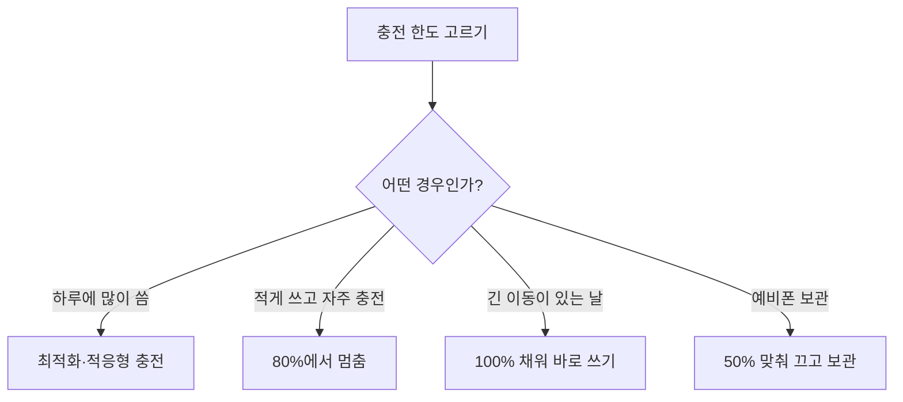

밤새 충전기에 꽂아 둔 휴대폰이 아침에 100%를 찍고 있으면 왠지 든든하다. 그런데 요즘 아이폰과 갤럭시에는 일부러 80%에서 충전을 늦추거나 멈추는 기능이 들어 있다. 꽉 채운 상태가 왜 배터리에 손해인지 알면, 내 하루 사용량에 맞춰 충전 한도를 직접 골라 배터리를 더 오래 쓸 수 있다.

{: .summary }
> - 배터리는 쓰지 않아도 늙는다. **꽉 찬 채로, 뜨겁게, 오래** 두는 조합이 노화를 앞당긴다.
> - Apple은 **16~22℃**에서 쓰기를 권하고, **35℃**가 넘는 환경에서는 용량이 영구적으로 줄 수 있다고 안내한다.
> - 하루에 많이 쓰면 **최적화 충전·적응형**, 적게 쓰면 **80% 상한**을 고른다. 오래 둘 예비폰은 **50% 안팎**으로 맞춰 끈다.

## 가만히 둬도 배터리는 늙는다

배터리는 쓸 때만 닳는 게 아니다. 가만히 놓아 두어도 늙는다. 연구자들은 이것을 보관 중 노화, 흔히 '캘린더 노화'라고 부르고, 충전과 방전을 되풀이하며 생기는 '사이클 노화'와 나눠서 본다.

Apple도 배터리의 화학적 나이는 만든 뒤 지난 시간만으로 정해지지 않고, 온도 이력과 충전 습관 같은 여러 요인이 얽혀 결정된다고 설명한다. 늙은 리튬이온 배터리는 담을 수 있는 전기의 양이 줄어 사용 시간이 짧아지고, 최대 성능도 떨어진다.

## 꽉 차 있을수록, 뜨거울수록 빨리 늙는다

그렇다면 가만히 있는 배터리 안에서는 무슨 일이 벌어질까. 리튬이온 배터리를 충전하면 리튬 이온이 양극에서 빠져나와 음극으로 들어간다. 휴대폰 배터리의 음극은 대부분 흑연이다. 충전량이 높을수록 흑연 안이 리튬으로 차고, 음극의 전위는 낮아진다.

전위가 낮은 음극 표면에서는 전해질이 더 쉽게 분해되고, 분해된 물질이 SEI(고체 전해질 계면)라는 얇은 막으로 쌓인다. 이 막은 원래 음극을 보호하는 데 필요하지만, 자라는 과정에서 리튬을 붙잡아 다시 쓰지 못하게 만든다. 오갈 수 있는 리튬이 줄어든 만큼 배터리 용량도 준다.

이 과정을 숫자로 확인한 연구가 있다. 2016년 독일 뮌헨공과대학 연구진(Keil 외)은 양극 재료가 다른 원통형 18650 셀 세 종류를 0%부터 100%까지 16개 충전 상태로 맞춰 여러 온도에 보관하며 용량이 얼마나 줄었는지 비교했다.

  
<b>3종류</b>양극 재료가 다른 원통형 18650 셀

  
<b>16개</b>0%~100% 사이에 맞춘 충전 상태

  
<b>20~30%p</b>용량 손실이 비슷하게 묶이는 구간 폭

결과는 직선이 아니었다. 용량 손실은 충전량에 비례해 매끄럽게 늘지 않고, 20~30%포인트쯤 되는 넓은 구간마다 비슷한 수준으로 묶이는 계단 모양을 보였다. 그리고 흑연이 절반 넘게 리튬으로 찬 높은 충전 구간에서 리튬 손실이 빨라졌다.

연구진은 낮은 음극 전위를 주된 원인으로 꼽았고, 흔히 떠올리는 높은 전압 때문에 생기는 양극 쪽 반응(전해질 산화, 금속 용출)은 상대적으로 작은 역할로 보았다. 결론은 높은 충전 상태, 곧 음극 전위가 낮아지는 구간에서 오래 보관하지 말라는 것이었다.

다만 이 실험은 휴대폰에 들어가는 납작한 파우치형 배터리가 아니라 원통형 셀로 한 것이다. 셀의 재료 조합에 따라 계단이 꺾이는 위치도 달라진다. 그래서 '몇 %부터 나쁘다'는 정확한 선을 내 휴대폰에 그대로 옮길 수는 없다. 옮길 수 있는 것은 방향이다. 꽉 찬 상태로 오래 머무를수록 보관 중 노화가 빨라진다는 것.

열은 여기에 기름을 붓는다. Apple은 기기를 16~22℃에서 쓰는 것이 가장 좋고, 35℃가 넘는 환경에 두면 배터리 용량이 영구적으로 줄 수 있다고 안내한다. 충전 중 특정 형태의 케이스가 열을 가둘 수 있으니, 충전하다 뜨거워지면 케이스를 벗기라고도 한다. 한여름 차 안에서 100%로 충전기에 꽂혀 있는 휴대폰은 높은 충전량과 높은 온도라는 두 조건이 겹친 셈이다.

## 아이폰·갤럭시는 이렇게 막는다

제조사들이 넣어 둔 기능은 이 원리를 그대로 따른다. 아이폰의 '최적화된 배터리 충전'은 사용자의 충전 습관을 기기 안에서 학습해, 충전기에 오래 연결돼 있을 것으로 예측될 때만 80% 이후 충전을 늦춘다. 기기를 뽑을 시간쯤에는 다 채워 두는 것이 목표다.

Apple은 이 기능의 목적을 '완전 충전 상태로 머무는 시간을 줄여 배터리 마모를 줄이는 것'이라고 적어 두었다. iPhone 15 이후 모델은 여기에 더해 충전 한도를 80%부터 100%까지 5% 단위로 고를 수 있다(설정 > 배터리 > 충전).

갤럭시는 One UI 6.1 이상에서 '배터리 보호'를 세 가지로 나눈다(설정 > 배터리 > 배터리 보호).

| 모드 | 동작 |
|---|---|
| 기본 | 100%에서 충전을 멈췄다가 95%로 떨어지면 다시 충전 |
| 최대 | 80%에서 충전을 멈춤 |
| 적응형 | 잠자는 동안 최대처럼 80%에 묶어 두었다가, 평소 일어나는 시간 전에 기본으로 바꿔 채움 |

잠드는 시간은 사용 패턴으로 추정하기 때문에 생활 리듬이 들쭉날쭉하면 적응형이 잘 맞지 않을 수 있다. One UI 6.1 이전 버전에는 최대 충전량을 85%로 묶는 선택지 하나만 있다.

## 내 하루에는 어떤 충전 한도가 맞을까

두 회사의 방식은 다르지만 겨냥하는 대상은 같다. 100%에 닿는 순간이 아니라 100% 근처에 머무는 시간이다. 이 차이를 알고 나면 판단이 쉬워진다.

하루가 끝날 때 배터리가 20%대까지 내려갈 만큼 많이 쓰는 사람에게 80% 상한은 수명보다 당장의 불편이 더 크다. 이런 경우에는 밤새 충전하는 시간만 골라 늦춰 주는 아이폰의 최적화 충전이나 갤럭시의 적응형이 절충점이 된다. 낮에도 책상에서 자주 충전할 수 있고 하루 사용량이 적다면, 80%에서 멈추는 설정으로 잃는 것은 거의 없다.

긴 이동이 있는 날 100%까지 채우는 것도 문제가 아니다. 다 채운 뒤 바로 쓰기 시작하면 꽉 찬 채 머무는 시간이 짧기 때문이다.

서랍에 넣어 둘 예비 휴대폰은 반대 경우다. Apple은 기기를 오래 보관할 때 완전히 채우지도, 완전히 비우지도 말고 50% 안팎으로 맞춘 뒤 꺼서 서늘하고 건조한 곳에 두라고 안내한다.

{: .tip }
> - [ ] 아이폰(iPhone 15 이후): 설정 > 배터리 > 충전에서 충전 한도를 고른다
> - [ ] 갤럭시(One UI 6.1 이상): 설정 > 배터리 > 배터리 보호에서 기본·최대·적응형 중 고른다
> - [ ] 충전하다 뜨거워지면 케이스를 벗긴다
> - [ ] 오래 둘 기기는 **50% 안팎**으로 맞춰 끄고 서늘하고 건조한 곳에 둔다

{: .interpret }
정리하면, 배터리를 늙게 하는 것은 충전기 자체가 아니라 '꽉 찬 채로, 뜨겁게, 오래' 두는 조합이다. 이 셋 중 무엇을 줄일 수 있는지는 각자의 하루가 정한다.

출처 4곳

- Apple 지원, About Optimized Battery Charging on iPhone: [support.apple.com](https://support.apple.com/en-us/108055)
- Apple, Batteries – Maximizing Performance: [apple.com](https://www.apple.com/batteries/maximizing-performance/)
- Samsung 지원, Galaxy Battery protection feature in One UI 6.1: [samsung.com](https://www.samsung.com/uk/support/mobile-devices/galaxy-battery-protection-feature-in-one-ui-6-1)
- Keil, P. 외, "Calendar Aging of Lithium-Ion Batteries I. Impact of the Graphite Anode on Capacity Fade", Journal of The Electrochemical Society 163(9), A1872–A1880 (2016): [doi.org](https://doi.org/10.1149/2.0411609jes)

