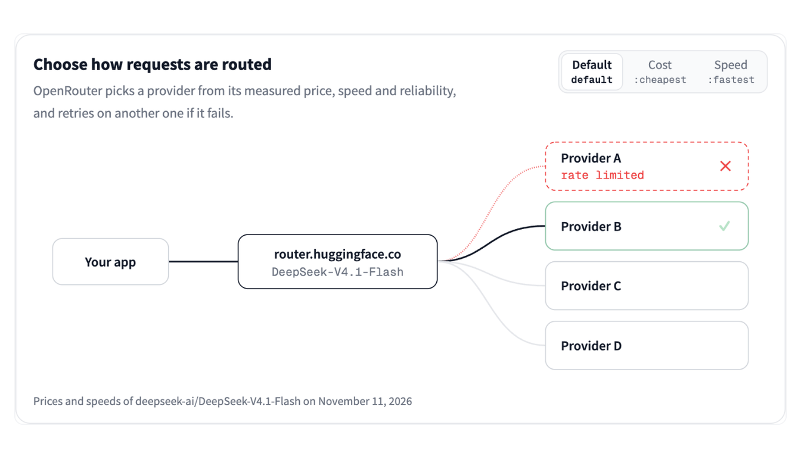

허깅페이스 토큰 하나로 DeepSeek·GLM 같은 오픈웨이트 모델을 불러 쓰던 사람에게 11월 16일 공지가 하나 붙었다. 언어 모델 요청이 이제 허깅페이스 자체 라우터가 아니라 OpenRouter의 라우터를 거친다는 내용이다. 코드는 그대로라는데, 그럼 무엇이 바뀌었고 무엇을 손봐야 할까. 이 글을 읽으면 모델 이름 뒤 접미사로 싼 곳·빠른 곳·특정 제공자를 고르고, 자체 제공자 키를 쓰던 설정이 깨졌는지 바로 확인할 수 있다.

{: .summary }
> - 언어 모델 요청은 **OpenRouter**가 가격·속도·안정성을 보고 제공자를 골라 보내고, 실패하면 **다른 제공자로 다시 보낸다**.
> - 모델 이름 뒤에 **`:cheapest`**, **`:fastest`**, **`:제공자이름`**을 붙여 고르는 방식을 바꾼다. 코드는 그대로다.
> - 언어 모델에는 **자체 제공자 API 키**를 더 이상 못 쓴다. 이미지·영상 제공자 키는 계속 된다.

## 무엇이 바뀌었나: 고르는 쪽이 OpenRouter로 넘어갔다

허깅페이스 Inference Providers는 허깅페이스 토큰 하나로 여러 추론 회사(제공자)의 모델을 부르는 서비스다. 11월 16일 허깅페이스 블로그는 언어 모델 요청을 자체 라우터 대신 OpenRouter 라우터로 돌린다고 밝혔다. 요청 주소(`router.huggingface.co`)와 토큰, API 형식은 그대로다.

달라진 것은 실패할 때의 동작이다. 예전에는 제공자 하나를 골라 보내고, 그곳이 실패하면 그 오류를 그대로 돌려줬다. 이제는 같은 요청 안에서 다음으로 나은 제공자에게 다시 보낸다. 공식 문서는 기본 라우팅이 실제로 내는 가격(캐시 적중률과 입력·출력 비율을 반영한 값), 처리 속도·첫 토큰 시간, 실패·도구 호출 오류·용량 거절 빈도를 실시간으로 비교해 고른다고 설명한다.

| 항목 | 11월 16일 전 | 11월 16일부터 |
|---|---|---|
| 제공자 고르기 | 허깅페이스 자체 라우터 | OpenRouter 라우터 |
| 제공자가 실패하면 | 그 오류를 돌려줌 | 다른 제공자로 다시 보냄 |
| 언어 모델 자체 키 | 쓸 수 있었음 | 못 씀 |
| 이미지·영상·음성 | 허깅페이스 경로 | 그대로(OpenRouter 안 거침) |

OpenRouter가 자기 트래픽에서 잰 값으로는 새 라우팅 뒤 용량 오류가 46% 줄고, 첫 토큰까지 시간은 16.9%, 처리량은 16.3% 나아졌다고 한다. 허깅페이스 요청만 따로 잰 숫자는 아니다.

## 싼 곳·빠른 곳은 모델 이름 뒤 한 단어로 고른다

설정 화면 없이 모델 이름에 접미사를 붙이는 방식이다. 모델 이름 하나만 넣을 수 있는 도구(코딩 에이전트 등)에서도 그대로 통한다.

| 모델 이름 | 어디로 가나 |
|---|---|
| `zai-org/GLM-5.3` | 기본: 가격·속도·안정성의 균형 |
| `zai-org/GLM-5.3:fastest` | 초당 토큰이 가장 많은 곳 |
| `zai-org/GLM-5.3:cheapest` | 가장 싼 곳 |
| `zai-org/GLM-5.3:novita` | 노비타만. 없으면 오류 |

제공자를 못 박으면(`:novita`처럼) 그곳이 실패해도 다른 곳으로 바꿔 보내지 않는다. 결과가 매번 같은 제공자에서 나와야 하는 평가·재현 작업이면 못 박고, 서비스 응답이 끊기지 않는 게 중요하면 기본이나 정책 접미사를 두는 편이 맞다.

~~~mermaid
flowchart TD
  A[요청 용도는?] --> B{같은 제공자 필수?}
  B -- 예 --> C[:제공자이름]
  B -- 아니오 --> D{가장 중요한 것}
  D -- 비용 --> E[:cheapest]
  D -- 응답 속도 --> F[:fastest]
  D -- 균형 --> G[접미사 없음]
~~~

에이전트처럼 같은 긴 프롬프트를 매 턴 다시 보내는 경우에는 캐시도 신경 쓸 만하다. 라우터는 대화가 프롬프트 캐시를 가진 제공자에 머물도록 보내며, 명시하려면 대화마다 고정된 UUID를 `X-HF-Session-Id` 헤더에 넣는다. 허깅페이스 파이썬·JS 클라이언트는 이 처리를 알아서 한다고 문서에 적혀 있다.

## 자체 키를 쓰던 설정은 지금 확인해야 한다

공지에서 유일하게 "Breaking change"라고 표시한 부분이다. 언어 모델 요청은 이제 OpenRouter를 거쳐 허깅페이스 계정이나 조직으로 청구되므로, 특정 제공자의 자기 API 키를 넣어 쓰던 방식은 언어 모델에서 더는 안 된다.

{: .warning }
제공자와 따로 맺은 약정이나 크레딧을 자체 키로 쓰고 있었다면, 언어 모델 요청은 이제 허깅페이스 청구서로 넘어간다. 쓰던 키가 그대로 적용된다고 가정하지 말고 사용량 화면에서 청구처를 먼저 확인한다.

대신 쓸 수 있는 통제 수단은 두 가지다. 모델 이름 접미사로 제공자를 고르거나, Inference Providers 설정에서 원치 않는 제공자를 끄는 것이다. 끈 제공자로는 요청이 가지 않고, 그 제공자를 접미사로 못 박으면 오류가 난다. 조직으로 청구되는 요청은 개인 설정이 아니라 조직 설정을 따른다. 이미지·영상 제공자의 자체 키는 계속 쓸 수 있다.

1. 토큰 설정에서 'Make calls to Inference Providers' 권한이 있는 fine-grained 토큰인지 확인한다
2. hf.co/settings/inference-providers 에서 데이터 정책상 쓰면 안 되는 제공자를 끈다
3. 조직 청구라면 `X-HF-Bill-To: 조직이름` 헤더를 넣고, 조직 설정의 제공자 목록도 같이 본다
4. 며칠 뒤 사용량 화면에서 요청이 어느 제공자로 갔는지, 비용이 어떻게 나뉘었는지 확인한다
{: .steps }

## 요금은 그대로, 대신 어디로 갔는지 보는 화면이 생겼다

요금 구조는 바뀌지 않았다. 제공자가 받는 값을 그대로 허깅페이스 청구서에 올리고, 허깅페이스는 웃돈을 붙이지 않는다. PRO 사용자는 매달 2달러, Team·Enterprise 조직은 좌석당 2달러의 크레딧을 받는다. 무료 계정은 포함 크레딧이 없어 크레딧을 사야 쓸 수 있다.

  
<b>2달러</b>PRO 월 포함 크레딧(Team·Enterprise는 좌석당)

  
<b>약 4분의 1</b>OpenRouter 기준 오픈웨이트 평균 토큰 단가(폐쇄형 대비)

새로 생긴 것은 투명성이다. 모델 페이지 위젯에 Providers 탭이 생겨 그 모델을 서비스하는 제공자별 입력·출력 가격, 속도, 최근 24시간 가동률을 보여 준다. Metrics 탭은 그중 가장 좋은 가격·처리량·첫 토큰 시간·컨텍스트 길이를 모아 보여 준다. 사용량 화면은 지출을 요청이 실제로 간 제공자별로 나눠 보여 준다.

{: .interpret }
제공자를 사람이 고르던 일이 "정책을 고르는 일"로 바뀌었다. 비용 관리는 접미사와 제공자 차단 목록, 그리고 사용량 화면 확인이라는 세 군데로 옮겨 갔다고 보는 편이 정확하다. 기본 라우팅은 가격만 보지 않으므로, 비용이 최우선이면 `:cheapest`를 명시해야 한다.

## 코딩 에이전트에 붙이는 길도 공식 문서에 있다

라우터는 모든 채팅 모델에 대해 OpenAI Chat Completions·Responses API와 Anthropic Messages API 형식을 받는다. 그래서 공식 문서에 Claude Code, Codex, OpenCode, Pi, Hermes Agent 연결 안내가 있다. 예를 들어 Claude Code는 `ANTHROPIC_BASE_URL`을 `https://router.huggingface.co`로, 인증 값을 허깅페이스 토큰으로 두고, 모델 슬롯 변수에 `zai-org/GLM-5.3` 같은 모델 이름을 넣는 방식이다. 여기에도 `:cheapest`·`:fastest`·제공자 접미사를 그대로 붙일 수 있다.

{: .note }
허깅페이스 블로그는 OpenRouter 계정을 허깅페이스에 연결하는 기능과, OpenRouter를 거치는 작업 종류를 늘리는 것을 다음 단계로 예고했다. 시점은 밝히지 않았다.

## 마무리

이번 변경으로 "어느 제공자를 쓸까"는 코드가 아니라 모델 이름 한 단어와 설정 화면의 차단 목록에서 정하는 일이 됐다. 오늘 할 일은 하나다. 자체 키로 쓰던 언어 모델 호출이 있었다면, 다음 청구서가 나오기 전에 사용량 화면에서 그 요청이 어디로 가고 누구에게 청구되는지부터 확인한다.

출처 5곳

- Hugging Face 블로그, 「Hugging Face and OpenRouter join forces to make open-weight models easy to run」(2026-11-16): [huggingface.co](https://huggingface.co/blog/openrouter)
- Hugging Face 문서, 「Routing and Providers」: [huggingface.co](https://huggingface.co/docs/inference-providers/routing)
- Hugging Face 문서, 「Pricing and Billing」: [huggingface.co](https://huggingface.co/docs/inference-providers/pricing)
- Hugging Face 문서, 「Prompt Caching」: [huggingface.co](https://huggingface.co/docs/inference-providers/prompt-caching)
- Hugging Face 문서, 「Claude Code」 연동 안내: [huggingface.co](https://huggingface.co/docs/inference-providers/integrations/claude-code)

