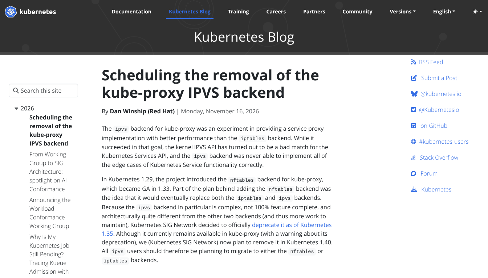

성능 때문에 kube-proxy를 ipvs 모드로 바꿔 둔 클러스터라면, 몇 번의 업그레이드 뒤에는 그 설정을 그대로 들고 갈 수 없다. 쿠버네티스 SIG Network가 11월 16일 공식 블로그에서 ipvs 백엔드를 없애는 일정을 밝혔기 때문이다. 우리 클러스터는 ipvs를 쓰고 있을까, 쓴다면 어디로 옮겨야 할까. 이 글을 읽으면 kube-proxy 모드를 확인하고, nftables와 iptables 중 어디로 옮길지와 전환 전에 점검할 항목을 정할 수 있다.

{: .summary }
> - ipvs 모드는 **1.35**에서 지원 중단(deprecated)됐고, 공식 문서 기준 **1.40**부터 기본으로 꺼지며 **1.43**에서 완전히 빠진다.
> - 쿠버네티스 **1.36 이상**, 노드 커널 **5.13 이상**이면 **nftables**로, 그렇지 않으면 **iptables**로 옮기라는 것이 공식 권고다.
> - kubeadm 클러스터는 `kube-proxy` ConfigMap의 `mode`를 바꾸고 kube-proxy 파드를 **다시 띄우면** 된다. iptables로 갈 때는 노드 **재부팅**을 권한다.

## 언제 사라지나: 1.40에 꺼지고 1.43에 빠진다

블로그 글은 ipvs 백엔드가 1.35에서 공식적으로 지원 중단됐고, 지금은 경고와 함께 남아 있지만 1.40에서 없앨 계획이라고 적었다. 현재 공식 문서 「Virtual IPs and Service Proxies」는 일정을 한 단계 더 나눠 둔다. 1.40부터 ipvs 지원이 기본으로 꺼지고 `KubeProxyIPVS` 기능 게이트로 다시 켤 수 있으며, 1.43에서 완전히 제거된다는 것이다.

| 버전 | 일어난 일·예정 |
|---|---|
| 1.29 | kube-proxy에 nftables 백엔드 추가 |
| 1.33 | nftables 백엔드 GA |
| 1.35 | ipvs 모드 지원 중단 표시 |
| 1.36 | nftables 성능·확장 수정이 포함된 권장 기준 버전 |
| 1.37 | 현재 최신(1.37.1), 기본 모드는 여전히 iptables |
| 1.40 | ipvs 기본 비활성, 기능 게이트로만 사용 |
| 1.43 | ipvs 완전 제거 |

릴리스 페이지에서 현재 최신 마이너 버전은 1.37이고, 1.37.1은 9월 15일에 나왔다. 이번 공지와 문서에는 1.40·1.43의 출시 날짜가 나오지 않으니, 지금 할 일은 날짜를 세는 것보다 우리 클러스터가 대상인지부터 가리는 것이다.

## 왜 없애나: 빠르려고 만든 백엔드가 결국 iptables에 기댔다

ipvs 백엔드는 iptables의 두 가지 성능 문제를 풀려고 나왔다. 하나는 서비스 IP마다 규칙을 하나씩 두어 새 연결이 규칙 목록을 처음부터 훑어야 하는 데이터 플레인 지연이고, 다른 하나는 서비스나 엔드포인트가 바뀔 때마다 규칙 전체를 다시 쓰는 컨트롤 플레인 지연이다. 블로그는 아주 큰 클러스터에서 kube-proxy가 iptables 갱신만으로 CPU 하나를 늘 100% 썼다고 설명한다.

ipvs는 해시 테이블로 앞의 문제를, 전체 재작성을 하지 않는 방식으로 뒤의 문제를 풀었다. 하지만 커널 IPVS API에 일괄 갱신이 없어 변경이 한꺼번에 많으면 오히려 느려질 수 있었다. 기본 부하 분산을 넘는 서비스 기능은 iptables로 처리해야 해서 같은 확장 문제를 안았고, Red Hat이 RHEL에서 iptables API를 없애기로 한 계획 때문에 RHEL에서는 ipvs 모드도 쓸 수 없게 된다.

IPVS 스케줄러를 고를 수 있다는 장점도 kube-proxy 구조에서는 힘을 못 쓴다. 노드마다 도는 kube-proxy가 스케줄러 상태를 공유하지 않아서, 분산용으로 설계된 Maglev 해싱(`mh`) 스케줄러조차 무작위 선택보다 낫지 않다고 블로그는 적었다.

{: .interpret }
ipvs를 고른 이유가 "iptables보다 빨라서"였다면 그 이유는 nftables가 이어받았고, "스케줄러를 고를 수 있어서"였다면 그 장점은 처음부터 기대만큼 나오지 않았던 셈이다. 남겨 둘 이유보다 옮길 이유가 많은 전환으로 읽힌다.

## 우리 클러스터가 ipvs인지 확인하는 법

kubeadm은 클러스터를 만들고 업그레이드할 때 kube-proxy 설정(KubeProxyConfiguration)을 `kube-system` 네임스페이스의 `kube-proxy` ConfigMap에 쓴다. 설정은 그 안의 `data.config.conf` 키에 있다. 확인 순서는 다음과 같다.

1. `kubectl get cm -n kube-system kube-proxy -o yaml`로 ConfigMap을 연다
2. `data.config.conf` 아래 `mode:` 값을 본다. `ipvs`면 이번 일정의 대상이다
3. `mode`가 비어 있으면 기본값을 쓰는 중이다. 1.37의 기본값은 iptables다
4. 관리형 서비스라면 kube-proxy 설정을 누가 관리하는지 공급자 문서에서 먼저 확인한다
{: .steps }

비어 있는 경우도 그냥 넘기지 않는 편이 좋다. 공식 문서는 앞으로 기본값이 nftables로 바뀔 예정이라며, 업그레이드 중에 프록시 백엔드가 뜻하지 않게 바뀌지 않도록 모든 클러스터에서 모드를 명시해 두라고 권한다.

## 어디로 옮길까: 버전과 커널이 갈림길이다

블로그의 권고는 간단하다. 쿠버네티스 1.36 이상이고 노드 커널이 5.13 이상이면 nftables로 옮긴다. nftables는 1.33에 GA가 됐지만 그 뒤의 성능·확장 수정이 1.36보다 앞선 버전에는 백포트되지 않았다. 그보다 오래된 버전이거나 커널이 낮으면 iptables로 옮긴다.

~~~mermaid
flowchart TD
  A[ipvs 모드 사용] --> B{1.36 이상?}
  B -- 예 --> C{커널 5.13 이상?}
  B -- 아니오 --> E[iptables로 전환]
  C -- 예 --> D[nftables로 전환]
  C -- 아니오 --> E
  D --> F[방화벽 점검]
  E --> G[노드 재부팅]
~~~

블로그에 따르면 nftables 백엔드는 기능이 다 갖춰졌고, 연결 수립 지연도 ipvs보다 아주 조금 낫다. 다만 블로그 스스로 "눈에 띄게 빠르다는 뜻이 아니라 iptables와 달리 느리지 않다는 것"을 보여 주려는 비교라고 덧붙였다. iptables 쪽도 2017년과는 다르다. 중복 규칙 제거, 할당 줄이기, 바뀐 서비스만 갱신하기(KEP-3453) 같은 개선이 쌓여 예전에 iptables를 못 쓰던 곳도 지금은 문제가 없을 수 있다고 한다.

kubeadm 클러스터에서 nftables로 옮기는 방법은 공식 문서의 재구성 절차 그대로다. `kubectl edit cm -n kube-system kube-proxy`로 `mode: ipvs`를 `mode: nftables`로 바꾸고, `kubectl delete po -n kube-system -l k8s-app=kube-proxy`로 파드를 지우면 DaemonSet이 새 설정으로 다시 띄운다. ipvs 전용 옵션을 따로 써 왔다면 그 옵션도 nftables 쪽 옵션으로 바꿔야 한다. iptables로 옮길 때는 설정을 바꾼 뒤 kube-proxy 재시작이 아니라 노드마다 재부팅하라고 블로그는 권한다.

{: .warning }
kubeadm이 띄우는 kube-proxy는 DaemonSet이라 노드별 설정을 지원하지 않는다. ConfigMap을 바꾸고 파드를 지우면 모든 노드가 한꺼번에 새 모드로 넘어가므로, 같은 구성의 스테이징 클러스터에서 먼저 바꿔 보고 서비스 트래픽을 확인한 뒤 운영에 적용한다.

## nftables로 옮기면 달라지는 네 가지

공식 문서는 iptables에서 nftables로 옮길 때 동작이 달라지는 항목을 따로 적어 두었다. ipvs에서 옮기는 경우에도 새 모드의 기본 동작은 같으니 미리 확인해 둘 목록이다. 아래 지표 이름은 문서가 iptables 모드 기준으로 든 것이다.

| 항목 | nftables 모드 기본 동작 | 확인·대응 |
|---|---|---|
| NodePort 주소 | 노드의 기본(primary) IP에서만 받음 | 모든 IP가 필요하면 `--nodeport-addresses 0.0.0.0/0` |
| 로컬 방화벽 | NodePort 허용 규칙을 자동으로 넣지 않음 | 방화벽에서 NodePort 범위 허용 |
| 커널 6.1 이전 conntrack 버그 | 우회 규칙을 깔지 않음 | `iptables_ct_state_invalid_dropped_packets_total` 확인 뒤 `--conntrack-tcp-be-liberal` |
| localhost NodePort | 기본으로 안 됨 | 1.37 알파 게이트 `KubeProxyNFTablesLocalhostNodePorts`와 `primary,localhost` |

localhost로 NodePort에 붙는 클라이언트가 있는지 모르겠다면 `iptables_localhost_nodeports_accepted_packets_total` 지표가 0보다 큰지 보라고 문서는 안내한다. 0이 아니면 누군가 루프백으로 NodePort 서비스에 접속하고 있다는 뜻이다.

## 마무리

ipvs를 떠나는 일 자체는 kube-proxy 설정 한 줄이지만, 그 한 줄 뒤에 NodePort 주소와 방화벽처럼 예전 모드가 대신 처리해 주던 일이 숨어 있다. 이번에 ipvs가 아닌 클러스터도 `mode` 값을 명시해 두면, 기본값이 nftables로 바뀌는 업그레이드 때 같은 점검을 한 번 더 하지 않아도 된다.

출처 4곳

- Kubernetes Blog, 「Scheduling the removal of the kube-proxy IPVS backend」(2026-11-16): [kubernetes.io](https://kubernetes.io/blog/2026/11/16/ipvs-removal/)
- Kubernetes Docs, 「Virtual IPs and Service Proxies」: [kubernetes.io](https://kubernetes.io/docs/reference/networking/virtual-ips/)
- Kubernetes Docs, 「Reconfiguring a kubeadm cluster」: [kubernetes.io](https://kubernetes.io/docs/tasks/administer-cluster/kubeadm/kubeadm-reconfigure/)
- Kubernetes, 「Releases」: [kubernetes.io](https://kubernetes.io/releases/)

