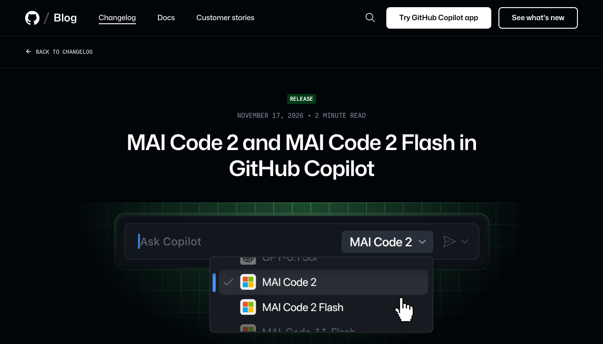
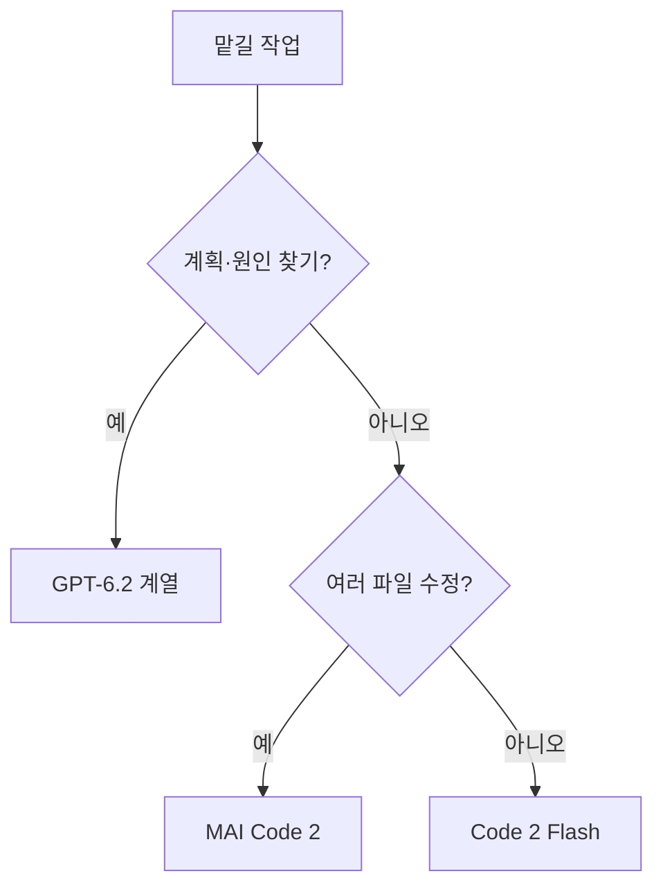

Copilot 채팅창의 모델 선택기에 이번 주에만 이름이 다섯 개 늘었다. 11월 17일 MAI Code 2와 MAI Code 2 Flash, GPT-6.2 Astra와 GPT-6.2 Sol이 들어왔고, 18일 Gemini 4 Neon이 뒤따랐다. Copilot은 쓴 토큰만큼 AI 크레딧을 깎는 사용량 기반 과금이라, 무엇을 고르느냐가 곧 한 달 사용량이다. 이 글을 읽으면 내 요금제에서 무엇을 고를 수 있는지, 작업마다 어떤 모델을 기본으로 둘지, 12월 18일 전에 무엇을 바꿔야 하는지 정할 수 있다.

{: .summary }
> - 같은 주에 들어온 다섯 모델의 출력 단가는 100만 토큰당 **0.25달러(MAI Code 2 Flash)**부터 **40달러(GPT-6.2 Astra)**까지 **160배** 차이 난다.
> - GPT-6.2 Astra·Sol과 Gemini 4 Neon은 **Pro+ 이상**에서만 고를 수 있고, MAI Code 2 계열의 지금 값은 **2027년 5월 17일**까지의 할인가다.
> - 조직 관리자는 **Settings > Copilot > Models**에서 새 모델이 자동으로 켜졌는지 보고, MAI-Code-1.1-Flash를 쓰는 곳은 **12월 18일** 전에 옮긴다.

## 다섯 모델은 맡기라는 일부터 다르다

GitHub 체인지로그가 밝힌 용도와 고를 수 있는 요금제는 다음과 같다.

| 모델 | 소개된 용도 | 고를 수 있는 요금제 |
|---|---|---|
| MAI Code 2 | 깊은 디버깅, 여러 파일 구현, 리팩터링, 저장소 전체 추론 | Pro, Pro+, Max, Business, Enterprise |
| MAI Code 2 Flash | 코드 설명, 부분 수정, 일상적인 버그 수정, 빠른 반복 | Free·Student 포함 모든 요금제 |
| GPT-6.2 Astra | 에이전트 코딩, 터미널 작업 | Pro+, Max, Business, Enterprise |
| GPT-6.2 Sol | 복잡한 에이전트 코딩, 꼼꼼한 코드 리뷰 | Pro+, Max, Business, Enterprise |
| Gemini 4 Neon | 에이전트 코딩, 여러 단계 도구 사용, 지식 작업 | Pro+, Max, Business, Enterprise |

다섯 모델 모두 VS Code, Visual Studio, JetBrains IDE, Xcode, Eclipse, Copilot CLI, Copilot 앱, github.com, GitHub 모바일의 모델 선택기에 나온다. GPT-6.2 두 모델과 Gemini 4 Neon은 차례로 배포되는 중이라 아직 안 보이는 계정도 있다. 체인지로그는 Flash를 Free·Student에도 열었다고 적었지만, 요금제 문서상 이 두 요금제는 모델을 직접 고르지 않고 자동 모델 선택만 쓴다.

성능은 모두 회사가 직접 잰 수치다. 마이크로소프트는 MAI Code 2가 코딩 벤치마크 평균에서 GPT-6.1 Sol 성능의 98%를 비용 40%로 냈다고 밝혔는데, 이 비용은 50% 할인가로 잰 값이다. 같은 글에서 기초 과학 연구나 아주 긴 에이전트 작업에는 아직 맞추지 않았다고 선을 그었다. GitHub은 GPT-6.2 두 모델이 초기 테스트의 코드 리뷰에서 이전 GPT-6 모델보다 실제 문제를 훨씬 많이 잡았다고 했고, 구글은 Gemini 4 Neon이 Gemini 4 Carbon에 가까운 품질을 작업당 더 적은 토큰 비용으로 낸다고 설명한다.

## 요금은 토큰 단가로 갈린다: 1크레딧은 1센트

Copilot은 대화마다 쓴 입력·출력·캐시 토큰에 모델별 단가를 곱해 AI 크레딧으로 바꾼다. 1크레딧은 0.01달러이고, 개인 요금제에는 매달 정해진 크레딧이 들어온다. 남은 크레딧은 다음 달로 넘어가지 않으며, 코드 자동 완성과 다음 편집 제안은 유료 요금제에서 크레딧을 쓰지 않는다.

  
<b>1,500</b>Pro(월 10달러) 한 달 AI 크레딧

  
<b>7,000</b>Pro+(월 39달러) 한 달 AI 크레딧

  
<b>20,000</b>Max(월 100달러) 한 달 AI 크레딧

아래 표는 100만 토큰당 기본 단가와, 입력 10만·출력 1만 토큰짜리 요청 하나를 캐시 없이 단순 계산한 값이다.

| 모델 | 입력 / 출력 (100만 토큰당) | 예시 요청 1건(계산값) |
|---|---|---|
| MAI Code 2 Flash | 0.05 / 0.25달러 | 약 0.75크레딧 |
| MAI Code 2 | 0.50 / 2.50달러 | 약 7.5크레딧 |
| GPT-6.2 Sol | 2 / 10달러 | 30크레딧 |
| Gemini 4 Neon | 3 / 15달러 | 45크레딧 |
| GPT-6.2 Astra | 8 / 40달러 | 120크레딧 |

이 계산이면 Pro+의 7,000크레딧으로 같은 요청을 GPT-6.2 Astra로는 58번, MAI Code 2로는 930번 남짓 보낼 수 있다.

단가가 바뀌는 조건도 있다. GPT-6.2 Astra는 입력이 27만 2천 토큰을 넘으면 긴 문맥 요금으로 바뀌어 입력 16달러, 출력 60달러가 되고, GPT-6.2 두 모델에는 캐시 쓰기 비용도 따로 붙는다. MAI Code 2와 Flash의 표 속 값은 2027년 5월 17일까지의 할인가이고, 그 뒤에는 두 모델 모두 지금의 두 배가 된다. 연간 결제로 예전 요청 기반 과금을 쓰는 Pro·Pro+ 사용자는 모델 배수가 따로 정해져 있어 이 계산이 그대로 맞지 않는다.

{: .interpret }
마이크로소프트가 든 "GPT-6.1 Sol 비용의 40%"는 할인가 기준이라, 정가로 돌아가면 같은 비교의 비용 비율은 단순 계산으로 약 80%가 된다. 같은 일이라도 모델마다 쓰는 토큰 수가 달라 실제 크레딧 차이는 표와 어긋날 수 있다. 그래도 단가가 수십 배 벌어지는 만큼, 어려운 단계에만 비싼 모델을 쓰는 습관의 효과는 크다.

## 작업마다 기본 모델을 나눠 두는 법

GitHub의 사용량 최적화 문서는 일의 성격으로 모델을 고르라고 권한다. 설계 결정이나 복잡한 디버깅은 추론 모델, 계획이 선 뒤의 실행은 중간급 모델, 리팩터링·서식·문서 수정 같은 정해진 일은 가벼운 모델이다. 특히 계획은 강한 추론 모델로 세우고 구현은 더 싼 모델로 하라고 적었다. 이번 다섯 모델의 소개 문구를 여기에 얹으면 이렇게 나뉜다.

1. 계획 단계는 Copilot CLI의 `/plan`이나 VS Code 에이전트 메뉴의 Plan에서 GPT-6.2 Astra나 Sol을 골라 세운다
2. 계획이 나오면 새 세션을 열고, 계획만 붙여 넣어 MAI Code 2로 구현한다
3. 코드 설명, 이름 바꾸기, 주석·문서 수정은 MAI Code 2 Flash에 맡긴다
4. 한 세션 안에서는 모델과 추론 수준을 바꾸지 않는다
{: .steps }

4번이 중요한 이유는 캐시다. 세션 중간에 모델을 바꾸면 새 모델이 앞 모델의 캐시를 쓸 수 없어, 다음 요청에서 전체 문맥을 새 입력 토큰으로 다시 낸다. 추론 수준이나 켜 둔 도구·MCP 서버를 바꿔도 마찬가지다. 캐시된 토큰은 보통 일반 입력가의 10% 수준이라 긴 에이전트 세션일수록 차이가 커진다. Copilot CLI에서는 세션 하나가 쓸 크레딧 상한을 미리 걸어 둘 수 있고, 상한에 닿으면 에이전트가 멈춘 뒤 계속할지 묻는다.

Gemini 계열을 쓰던 팀이라면 Neon을 따로 볼 만하다. Copilot의 Gemini 4 Carbon 할인가가 12월 1일 끝나면 단가가 두 배로 올라 Neon보다 비싸진다.

## 고르기 싫다면 Fusion, High와 Max는 Pro+부터

Copilot Fusion은 모델 하나가 아니라 요청마다 모델과 실행 방식을 골라 주는 라우터다. 모델 선택기에서 Fusion을 고르고 노력 수준만 정하면 된다. 요청마다 모델 하나가 끝내는 Single, 싼 모델의 초안을 심사 모델이 보고 필요하면 더 강한 모델로 올리는 Cascade, 여러 모델이 나란히 비평하고 원래 모델이 고치는 Critique 가운데 하나를 고른다.

| 노력 수준 | 맞는 일 | 요금제 |
|---|---|---|
| Fusion Standard | 일상 작업, 작업마다 모델 하나 | 모든 요금제 |
| Fusion High | 복잡한 버그, 여러 파일 수정처럼 범위가 정해진 큰 작업 | Pro+, Max, Business, Enterprise |
| Fusion Max | 가장 깊은 추론과 분석이 필요한 작업 | Pro+, Max, Business, Enterprise |

11월 17일 업데이트로 MAI Code 2가 Fusion Standard, GPT-6.1 Terra가 High, Claude Sonnet 5.5가 Max의 모델 목록에 들어갔다. Fusion 자체 요금은 없고 Fusion이 부른 모델마다 기본 단가로 크레딧이 빠지는데, High와 Max는 한 작업에 여러 모델을 부를 수 있어 Standard보다 많이 쓸 수 있다.

할인도 있다. 유료 요금제는 11월 30일까지 Fusion으로 쓴 모델 비용을 30% 할인받고, 자동 모델 선택을 Copilot Chat이나 클라우드 에이전트에서 쓰면 모델 비용이 10% 깎인다.

Fusion이 초안을 버려도 그 초안이 이미 작업 공간에서 고친 파일은 자동으로 되돌아가지 않는다. 커밋 전에 변경 내역을 직접 훑어봐야 한다.

## 관리자와 개인이 12월 18일 전에 할 일

Business·Enterprise 조직에서 기본 모델 활성화(default model enablement)가 켜져 있으면, 관리자가 전역 기본값을 끄거나 해당 모델을 따로 끄지 않는 한 새 모델은 자동으로 켜진다. 이번 다섯 모델도 같다. 조직 설정은 프로필 사진 > Organizations > 조직 선택 > Settings > 사이드바 "Code, planning, and automation"의 Copilot > Models에서 바꾼다. 엔터프라이즈 소유자가 정책을 정해 두었다면 조직에서 덮어쓸 수 없다.

{: .warning }
Business·Enterprise의 AI 크레딧은 사용자별 할당량을 결제 단위로 모아 쓴다. 새 모델을 켜 둔 채 두면 단가가 높은 모델 몇 번이 팀 전체 할당량을 빠르게 줄일 수 있으니, 허용할 모델부터 정해 정책에 반영한다.

MAI-Code-1.1-Flash는 12월 18일 모든 Copilot 경험에서 내려가고, GitHub은 최신 MAI Code Flash 모델로 옮기라고 안내했다. 워크플로나 연동에 모델 이름을 적어 둔 곳이 있으면 그 전에 바꾸고, Enterprise 관리자는 대체 모델이 모델 정책에서 켜져 있는지 확인한다. 옛 모델은 따로 지우지 않아도 종료일에 목록에서 빠진다.

개인 요금제에서 초과 과금이 걱정되면 Bundled AI credits 예산을 0달러로 두고 "Stop usage when budget limit is reached"를 켠다. 클라이언트가 오래되면 모델 가격과 사용량이 틀리게 보일 수 있으니(VS Code 1.120, Copilot CLI 1.0.48 이상 권장) 새 모델을 고르기 전에 먼저 올려 둔다.

## 마무리

모델 목록은 다음 달에도 늘어난다. 모델 이름이 아니라 "계획·구현·잡일" 세 칸에 각각 무엇을 둘지로 정해 두면, 새 모델이 오거나 MAI Code 2 계열 할인가가 끝나는 날에도 그 칸 하나만 바꿔 계산하면 된다.

출처 12곳

- GitHub Changelog, 「MAI Code 2 and MAI Code 2 Flash in GitHub Copilot」(2026-11-17): [github.blog](https://github.blog/changelog/2026-11-17-mai-code-2-and-mai-code-2-flash-in-github-copilot/)
- GitHub Changelog, 「OpenAI’s GPT-6.2 Astra and GPT-6.2 Sol now available」(2026-11-17): [github.blog](https://github.blog/changelog/2026-11-17-openais-gpt-6-2-astra-and-gpt-6-2-sol-now-available/)
- GitHub Changelog, 「Gemini 4 Neon in GitHub Copilot」(2026-11-18): [github.blog](https://github.blog/changelog/2026-11-18-gemini-4-neon-in-github-copilot/)
- GitHub Changelog, 「GitHub Copilot Fusion updates: more availability, benchmarks, and models」(2026-11-17): [github.blog](https://github.blog/changelog/2026-11-17-github-copilot-fusion-updates-more-availability-benchmarks-and-models/)
- GitHub Changelog, 「Upcoming deprecation of MAI-Code-1.1-Flash in December」(2026-11-17): [github.blog](https://github.blog/changelog/2026-11-17-upcoming-deprecation-of-mai-code-1-1-flash-in-december/)
- Microsoft AI, 「MAI Code 2 and Code 2 Flash: Everyday coding at scalable prices」(2026-11-17): [microsoft.ai](https://microsoft.ai/news/introducing-mai-code-2-and-mai-code-2-flash/)
- GitHub Docs, 「Models and pricing for GitHub Copilot」: [docs.github.com](https://docs.github.com/en/copilot/reference/copilot-billing/models-and-pricing)
- GitHub Docs, 「Usage-based billing for individuals」: [docs.github.com](https://docs.github.com/en/copilot/concepts/billing-and-usage/individuals/billing)
- GitHub Docs, 「About GitHub Copilot Fusion」: [docs.github.com](https://docs.github.com/en/copilot/concepts/models/copilot-fusion)
- GitHub Docs, 「Configuring access to AI models in GitHub Copilot」: [docs.github.com](https://docs.github.com/en/copilot/how-tos/copilot-on-github/set-up-copilot/configure-access-to-ai-models)
- GitHub Docs, 「Managing policies and features for GitHub Copilot in your organization」: [docs.github.com](https://docs.github.com/en/copilot/how-tos/administer-copilot/manage-for-organization/manage-policies)
- GitHub Docs, 「Optimizing your AI usage to maximize efficiency and reduce cost」: [docs.github.com](https://docs.github.com/en/copilot/tutorials/optimize-ai-usage)

