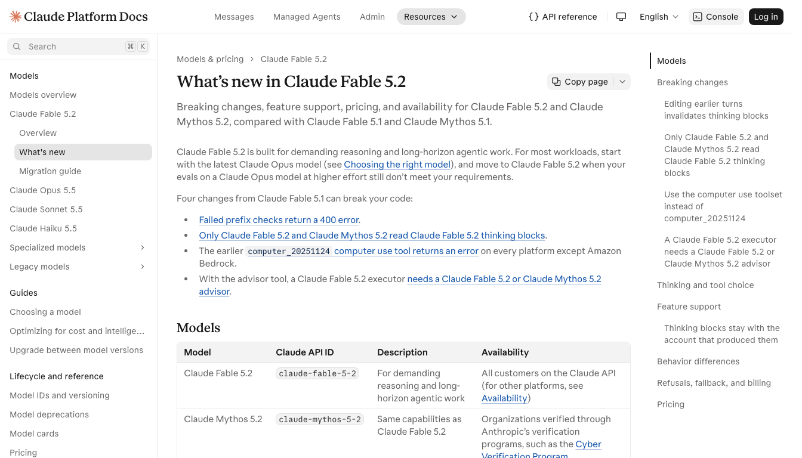
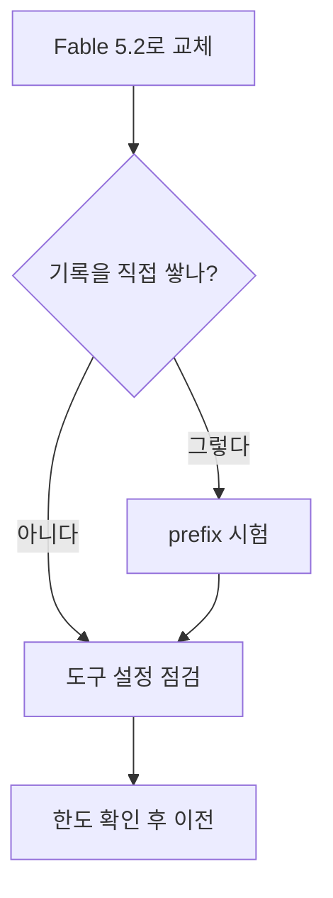

11월 9일 Anthropic이 Claude Fable 5.2(`claude-fable-5-2`)를 내놨다. 100만 토큰당 입력 $8, 출력 $40으로 Fable 5.1보다 20% 싸니, 5.1을 쓰는 팀이라면 모델 이름 한 줄만 바꾸고 싶어진다. 그런데 이번 판에는 5.1 코드를 그대로 옮기면 깨지는 변경이 네 가지 있다. 이 글을 읽으면 내 코드가 이름만 바꿔도 되는 쪽인지 먼저 고칠 곳이 있는 쪽인지 가르고, 운영 트래픽을 옮기는 순서를 정할 수 있다.

{: .summary }
> - 요금은 입력 **$8**·출력 **$40**(100만 토큰당)로 5.1보다 **20%** 낮다. 캐시 읽기도 $0.25에서 **$0.20**으로 내렸다.
> - Claude Code·Agent SDK·Managed Agents가 대화 기록을 관리한다면 **모델 이름**과 advisor 설정만 바꾸면 된다.
> - `messages` 배열을 직접 쌓는다면 **prefix check 시험**부터 돌리고, computer use 도구와 advisor 모델을 바꾼 뒤 옮긴다.

## 요금은 20% 내렸고, 기본 사양은 그대로다

Fable 5.2는 5.1과 같은 자리의 모델이다. 컨텍스트 창 100만 토큰, 요청당 출력 128K 토큰, 늘 켜진 adaptive thinking, 강제 도구 호출(`tool_choice`의 any·tool) 금지, 30일 데이터 보존 요구가 모두 5.1과 같다. 달라진 것은 값이다.

| 항목(100만 토큰당) | Fable 5.1 | Fable 5.2 |
|---|---|---|
| 입력 / 출력 | $10 / $50 | $8 / $40 |
| 캐시 쓰기(5분 / 1시간) | $12.50 / $20 | $10 / $16 |
| 캐시 읽기 | $0.25 | $0.20 |
| Batch 입력 / 출력 | $5 / $25 | $4 / $20 |

서두를 이유는 크지 않다. 모델 지원 종료 표에 Fable 5.1의 은퇴 시점은 "2027년 9월 1일보다 이르지 않음"으로 적혀 있다. 대신 5.2의 속도 제한(rate limit)은 5.1·Fable 5가 함께 쓰는 한도와 따로 잡히니, 트래픽을 넘기기 전에 한도부터 확인한다. 같은 능력의 Claude Mythos 5.2는 Anthropic 인증 프로그램을 거친 조직만 쓸 수 있다.

새로 모델을 고르는 경우라면 Anthropic은 대부분의 작업에 최신 Opus부터 쓰고, Opus를 높은 effort로 돌려도 평가 기준을 채우지 못할 때 Fable 5.2로 올리라고 권한다. 이 글은 이미 Fable 5.1을 쓰고 있는 경우를 다룬다.

## 대화 기록을 누가 쌓는지가 갈림길이다

Claude Code, claude.ai, Claude Managed Agents, Claude Agent SDK가 대화 기록을 관리한다면 prefix check 때문에 바꿀 것은 없다. Managed Agents는 에이전트의 모델 이름을 바꾸면 되고, 에이전트에 advisor가 붙어 있으면 advisor의 `model`도 `claude-fable-5-2`로 함께 바꾼다. 에이전트 `model`에 `speed: "fast"`가 들어 있으면 그 설정은 지운다.

`messages` 배열을 내 코드가 직접 쌓는다면 사정이 다르다. 5.2는 요청마다 prefix check를 한다. 대화 중간에 `system`, `tools`, 앞선 메시지를 고친 뒤 thinking 블록을 다시 보내면 400 오류가 나고, 같은 요청을 다시 보내도 풀리지 않는다.

## 코드가 깨지는 네 곳

| 바뀐 점 | 증상 | 고치는 법 |
|---|---|---|
| prefix check | 대화 중 `system`·`tools`·앞 메시지를 고치고 thinking을 다시 보내면 400 | 기록은 덧붙이기만, 바꿀 땐 새 대화 |
| 5.2 thinking 블록 | 5.1 등 다른 모델로 넘어가면 블록이 버려진다(오류는 아님) | 라우터·fallback 경로 확인 |
| `computer_20251124` | Amazon Bedrock 밖에서 400 | `computer_toolset_20260801`로 선언 |
| advisor 도구 | 5.2 실행 모델에 다른 advisor를 붙이면 400 | advisor `model`을 `claude-fable-5-2`로 |

prefix check에는 함정이 하나 더 있다. MCP 커넥터에서 서버의 도구 목록을 고정(pin)하지 않았다면, 요청 사이에 도구 목록이 바뀌는 것도 5.2 블록에서는 수정으로 친다. 5.1이나 Opus 5.5 블록에서는 수정이 아니었다. 그래서 MCP 커넥터를 쓰면 지금 모델에서 시험을 통과해도 `claude-fable-5-2`로 한 번 더 돌려 봐야 한다.

thinking 블록은 한쪽으로만 이어진다. Claude API와 Google Cloud(Google 관리형)에서 5.1로 쓰던 대화를 5.2로 넘기면 앞선 추론이 이어지지만, 반대로 5.2에서 5.1로 가면 5.1은 5.2 블록을 읽지 못한다. 라우터 전환, 클라이언트 재시도, 거절 fallback이 대화를 옮기면 API가 그 블록을 버린다. 요청은 성공하고 버린 입력 토큰은 청구되지 않지만, 옮긴 뒤 첫 턴은 앞선 추론 없이 일하느라 비용과 지연이 늘 수 있다. 5.2 블록은 만든 계정(또는 연결된 계정)에서만 통하니, 저장한 대화를 다른 계정으로 다시 돌릴 때도 버려진다.

computer use는 베타 헤더를 빼고 `computer_toolset_20260801` 항목을 `name`과 화면 크기 없이 보낸 뒤, 에이전트 루프를 도구 세트 방식에 맞게 고친다. Bedrock에서는 5.2도 옛 도구를 받는다. advisor 도구(베타)는 advisor가 실행 모델만큼 능해야 해서, 5.2 실행 모델은 5.2나 Mythos 5.2 advisor만 받는다. advisor `model`을 바꾸는 것도 `tools` 수정이니 새 대화에서 바꾸고, 5.2 advisor의 조언은 암호화돼 오니 코드가 조언 글을 읽는다면 결과 형식을 확인한다.

## 옮기는 순서

Claude Code를 쓴다면 `/claude-api migrate this project to claude-fable-5-2`로 코드 수정을 맡길 수 있다. 시험과 한도 확인은 아래 순서대로 한다.

1. prefix check 시험을 돌린다. `thinking-binding-controls-2026-08-01` 베타 헤더와 `prefix_mismatch_behavior: "drop_block"`을 켜고 한 세션을 돌려 `input_transformations`를 기록한 뒤, `prefix_binding_mismatch` 항목마다 원인이 된 수정을 고친다
2. `computer_20251124`를 `computer_toolset_20260801`로, advisor `model`을 `claude-fable-5-2`로 바꾼다
3. 5.2 속도 제한을 확인한다. 5.1·Fable 5와 따로 잡힌다
4. 프롬프트에서 "생각하지 말고 바로 답하라" 같은 줄을 지우고 effort를 낮춘다. `max_tokens`가 작으면 생각만 하다 글 없이 끝날 수 있으니 늘린다
5. 모델 이름을 `claude-fable-5-2`로 바꾸고, 자체 평가로 effort별 품질·비용·지연을 다시 잰다. Bedrock은 `global.anthropic.claude-fable-5-2` 또는 `us.anthropic.claude-fable-5-2`이고 `bedrock-runtime` 엔드포인트만 쓴다
{: .steps }

{: .warning }
운영에서는 `prefix_mismatch_behavior`를 기본값 `"error"`로 둔다. `"drop_block"`은 문제 블록을 버리고 그 추론 없이 계속하게 하는 임시방편이라 고칠 때까지만 쓴다. 블록을 버리면 출력 토큰이 늘 수 있다.

코드를 바꾸지 않아도 달라지는 행동도 있다. Anthropic 테스트에서 5.2는 medium 이상 effort에서 생각을 줄이라는 지시를 따르지 않았고, high 이상에서는 거의 모든 답 전에 생각했다. xhigh·max 같은 높은 effort의 코딩 작업에서는 서브에이전트를 띄워 자기 작업을 검토했는데, 5.1은 같은 작업에서 그러지 않았다. 긴 다단계 작업에서는 남은 일 목록이나 계속할지 묻는 말로 턴을 끝내기도 하는데, low·medium effort에서 더 잦다.

{: .interpret }
단가 20% 인하가 곧 청구액 20% 감소는 아니다. 생각을 지시로 줄이지 못하고 높은 effort에서 서브에이전트가 붙으면 출력 토큰이 늘어 인하분을 깎아 먹을 수 있다. 5.1에서 쓰던 effort 값을 그대로 옮기기보다 작업마다 effort를 다시 골라야 실제로 싸진다.

## 다음 교체를 위해 남길 것

네 가지 변경 중 둘은 thinking 블록이 그것을 만든 대화와 모델에 묶인다는 데서 나온다. 그러니 이번 교체에서 오래 남길 수정은 대화 기록을 고치지 않고 덧붙이기만 하는 구조다. 지시나 도구를 바꿔야 할 때 새 대화를 열도록 짜 두면, 라우터가 모델을 바꿔도 잃는 것은 앞선 추론뿐이고 요청은 깨지지 않는다.

출처 6곳

- Claude Platform Docs, 「What's new in Claude Fable 5.2」: [platform.claude.com](https://platform.claude.com/docs/en/models/fable-5-2/whats-new-fable-5-2)
- Claude Platform Docs, 「Claude Fable 5.2 and Claude Mythos 5.2 migration guide」: [platform.claude.com](https://platform.claude.com/docs/en/models/fable-5-2/migration-guide)
- Claude Platform Docs, 「Pricing」: [platform.claude.com](https://platform.claude.com/docs/en/about-claude/pricing)
- Claude Platform Docs, 「Models overview」: [platform.claude.com](https://platform.claude.com/docs/en/about-claude/models/overview)
- Claude Platform Docs, 「Model deprecations」: [platform.claude.com](https://platform.claude.com/docs/en/about-claude/model-deprecations)
- Claude Platform Docs, 「Release notes」(2026년 11월 9일 항목): [platform.claude.com](https://platform.claude.com/docs/en/release-notes/overview)

