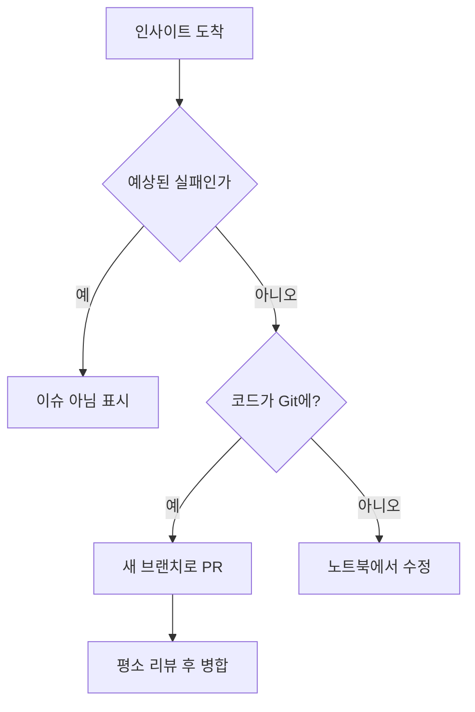

밤사이 잡은 '성공'으로 끝났는데 아침 대시보드의 매출 숫자가 평소의 절반이다. 원인을 찾으려면 실행 로그, 위쪽 테이블, 계보(lineage)를 차례로 뒤져야 하고 보통 몇 시간이 간다. Databricks가 11월 19일 공개 베타로 연 Genie ZeroOps는 이 추적을 사람이 묻기 전에 먼저 해 두는 에이전트다. 이 글을 읽으면 ZeroOps를 켜는 순서와, 켜기 전에 감시 범위·알림·PR 브랜치를 어떻게 정할지 판단할 수 있다.

{: .summary }
> - 워크스페이스 관리자가 **Previews 페이지**에서 켜고, 각자 Jobs & Pipelines에서 감시 범위를 정하면 **지난 24시간**의 문제부터 채워진다.
> - Git에서 도는 잡은 **Create PR**로 새 브랜치에 수정 커밋을 올린다. 기본 브랜치 이름을 대면 리뷰 없이 바로 커밋되니 **브랜치 보호**를 먼저 건다.
> - 성능·비용 저하와 모델·앱은 **감시하지 않는다**. 테이블 품질 감지에는 따로 과금되는 데이터 품질 모니터링이 필요하다.

## ZeroOps는 묻기 전에 먼저 돈다

ZeroOps는 내가 맡은 잡·파이프라인·테이블을 뒤에서 계속 지켜보다가 문제를 찾고, 원인을 짚고, 고칠 방법을 내놓는다. 같은 Genie 계열인 Genie Code가 프롬프트를 받아야 움직이는 것과 달리, ZeroOps는 문제가 생기는 순간 조사를 시작해 사람이 열어 보기 전에 분석을 끝내 둔다. 찾는 문제는 세 종류다. 실패한 잡·파이프라인, 성공으로 끝났지만 테이블을 덜 채운 잡, 갱신이 멈췄거나 행이 빠진 테이블이다.

결과는 '인사이트' 단위로 받은편지함에 쌓인다. 인사이트마다 감지한 내용, 근본 원인(코드 변경·스키마 변경·위쪽 잡 실패 등), 제안하는 수정과 고칠 곳(노트북 등)으로 가는 링크가 들어 있다. 다음 잡 실행이 성공하면 인사이트는 저절로 '해결됨'으로 바뀌고, 상태는 보통 15분 안에 갱신된다.

## 켜는 순서: 관리자 한 번, 사용자 각자 한 번

준비물은 셋이다. 워크스페이스에 ZeroOps 미리보기가 켜져 있어야 하고, 감시할 자산에 OWNER·CAN MANAGE·CAN VIEW 중 하나의 권한이 있어야 한다. Git 저장소 코드를 돌리는 잡이라면 읽기 권한이 있는 Git 자격 증명을 넣고, PR까지 만들려면 쓰기 권한도 준다.

1. 워크스페이스 관리자가 **Previews** 페이지에서 Genie ZeroOps를 켠다
2. 사이드바 **Jobs & Pipelines**에서 **Open ZeroOps**를 누른다
3. 처음이면 **Configure**를 눌러 열리는 Genie Code 채팅에서 제안된 범위를 고르거나 "all owned jobs"처럼 문장으로 적는다
4. ZeroOps가 지난 24시간 안에 실패한 잡과 낡거나 덜 찬 테이블부터 인사이트로 채운다
5. 범위를 바꿀 때는 받은편지함 오른쪽 위 **Configure**에서 넣고 뺄 대상을 말로 적는다
{: .steps }

감시 범위를 정하는 것은 그 자산을 끌 때까지 대규모 언어 모델이 계속 처리하는 데 동의한다는 뜻이다. Git 잡이면 저장소 내용도 처리 대상이고, 조사 중에는 내가 접근할 수 있는 테이블에 쿼리를 날릴 수도 있다. 모델은 Databricks가 자기 보안 경계 안에 올린 Anthropic·OpenAI 모델이며, 모델 호출은 워크스페이스 리전 안에 머물고 모델 회사는 프롬프트와 응답을 보관하지 않는다고 Databricks는 밝혔다. 처음에는 운영 전체보다 내가 소유한 비핵심 잡으로 범위를 좁혀 시작하는 편이 안전하다.

## 알림과 공유는 '누가 무엇을 보게 되나'부터 정한다

ZeroOps는 중요하다고 판단한 인사이트를 Slack, Microsoft Teams, PagerDuty, 일반 웹훅으로 보낸다. 이메일은 아직 안 된다. 받을 곳은 워크스페이스 관리자가 알림 대상(notification destination)으로 먼저 만들어 둬야 하고, 그다음 Configure 채팅에 `Send ZeroOps insight notifications to <대상 이름>`처럼 적으면 저장된다. Jira 작업 항목으로 받고 싶다면 Jira Cloud 자동화의 수신 웹훅 주소를 일반 웹훅 대상으로 등록한다.

알림의 제목·요약은 나가기 전에 이름·이메일 같은 민감 정보를 가린다. 다만 Slack처럼 바깥에 남은 사본은 Databricks의 보존·삭제 설정이 미치지 않는다. 받은편지함은 기본적으로 설정한 사람만 보며, 워크스페이스 사용자에게 개인 단위로 최대 25명까지 공유할 수 있다. 그룹이나 서비스 주체에는 공유가 안 된다.

{: .warning }
공유받은 사람은 원래 자산 권한이 없어도 인사이트에 담긴 코드 일부, 수정안, 표본 데이터 행을 본다. 개인정보가 든 테이블을 감시 범위에 넣었다면 공유 명단은 그 테이블 권한을 이미 가진 사람 안에서 고른다.

## PR은 사람이 눌러야 나가지만, 브랜치 이름은 조심한다

ZeroOps는 운영 데이터와 코드를 승인 없이 바꾸지 않는다. Git 저장소 코드를 돌리는 잡이 실패하면 저장소를 읽어 원인을 찾고 수정안을 준비해 두지만, 뒤에서 푸시하지는 않는다. 사람이 **Create PR**을 누르고 푸시를 확인해야 브랜치에 커밋이 올라가고, ZeroOps는 PR을 열 수 있는 링크를 준다.

| 경우 | ZeroOps가 하는 일 | 먼저 할 일 |
|---|---|---|
| Create PR만 누름 | 새 브랜치에 커밋·푸시 | PR을 열어 평소처럼 리뷰 |
| 기존 브랜치 이름을 댐 | 새 커밋 추가, 강제 푸시 없음 | 열린 PR이 있으면 거기 반영되는지 확인 |
| 기본 브랜치 이름을 댐 | 그 브랜치에 바로 커밋, PR 리뷰 건너뜀 | 브랜치 보호 규칙으로 직접 푸시 차단 |
| 워크스페이스에 둔 코드 | 요청하면 Genie Code가 바로 적용 | 적용 전 수정안 검토 |

맞춤 지침에 브랜치 이름을 적어 두면 Create PR이 늘 그 브랜치로 간다. 예상된 실패는 맞춤 지침으로 알림을 거르거나 인사이트를 'Not an issue'로 표시해 정리한다. 인사이트 하나가 들어왔을 때의 갈림길은 아래와 같다.

## 아직 못 하는 일

- 감시 대상은 잡·파이프라인·테이블뿐이다. 모델과 앱은 보지 않는다.
- 실패와 데이터 품질 문제만 잡는다. 느려지거나 비용이 오른 것은 감지하지 않는다.
- 워크스페이스 단위로 돈다. 계정 전체를 한 번에 보지 않는다.
- HIPAA 준수 대상이 아니다.
- 테이블 품질 감지(커밋이 평소보다 늦게 오거나 행 수가 기대 범위 아래로 떨어지는 것)는 따로 과금되는 데이터 품질 모니터링(Data Quality Monitoring)이 있어야 한다.

Databricks는 비공개 미리보기 동안 수백 개 회사에서 8만 건 넘는 실제 파이프라인 문제를 관찰했고, 그 절반 이상은 회사 고유의 사정을 알아야 분류·해결할 수 있었다고 밝혔다. 이번 베타에 맞춤 지침, 공유 받은편지함, 요약 알림, 클릭 한 번으로 만드는 PR이 들어간 이유다.

{: .interpret }
켜자마자 정확한 진단을 기대하기보다, 처음 한두 주는 오탐을 'Not an issue'로 표시하고 "재시도를 권하기 전에 위쪽 데이터 신선도부터 확인" 같은 팀 규칙을 맞춤 지침에 쌓는 기간으로 보는 편이 현실적이다.

ZeroOps가 내놓는 수정안은 결국 팀이 적어 둔 규칙만큼 정확해진다. 장애 대응 순서가 몇몇 사람의 머릿속에만 있다면, 그것을 맞춤 지침 문장으로 옮기는 일부터가 도입 준비다.

출처 4곳

- Databricks 문서, 「Genie ZeroOps」(2026-11-19 갱신): [docs.databricks.com](https://docs.databricks.com/aws/en/zeroops/)
- Databricks 문서, 「Get started with Genie ZeroOps」(2026-11-19 갱신): [docs.databricks.com](https://docs.databricks.com/aws/en/zeroops/get-started)
- Databricks 블로그, 「Genie ZeroOps, now in public beta: An autonomous agent that fixes data pipelines, with lessons from 80,000 customer issues」(2026-11-19): [databricks.com](https://www.databricks.com/blog/genie-zeroops-now-public-beta-autonomous-agent-fixes-data-pipelines-lessons-80000-customer)
- Databricks 릴리스 노트, 「November 2026」(11월 12일 Genie ZeroOps Beta 항목): [docs.databricks.com](https://docs.databricks.com/aws/en/release-notes/product/2026/november)

