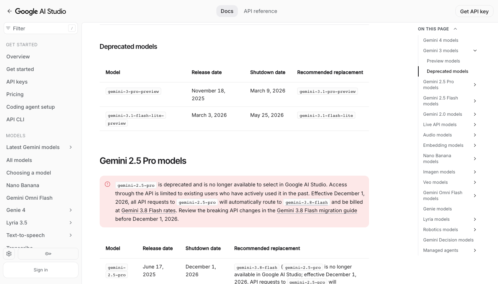

11월 30일과 12월 1일 사이에 구글·Anthropic·OpenAI의 API에서 모델 ID와 기능 여러 개가 한꺼번에 바뀐다. 날짜는 비슷해도 코드를 그대로 두었을 때 벌어지는 일은 회사마다 다르다. 구글은 옛 ID로 온 요청을 새 모델에 넘겨 계속 답하고, Anthropic은 은퇴한 모델 요청을 실패시키며, 값이 오르는 모델은 같은 코드에 청구액만 커진다. 이 글을 읽으면 내 코드에 박힌 모델 ID가 이 셋 중 어디에 걸리는지 가려내고, 남은 닷새 동안 무엇부터 바꿀지 정할 수 있다.

{: .summary }
> - `claude-sonnet-4-5-20250929`는 **11월 30일** 은퇴해 요청이 실패한다. 날짜 없는 `claude-sonnet-4-5`도 같고, 대체 모델은 Claude Sonnet 5.5다.
> - **12월 1일**부터 `gemini-2.5-pro`는 Gemini 3.8 Flash가, `gemini-2.5-flash`는 Gemini 3.5 Flash-Lite가 대신 답한다. 오류 없이 모델과 요금이 바뀐다.
> - Gemini 4 Carbon·Argon은 12월 1일 단가가 **2배**가 되고, GPT-5.6 Sol 할인가와 OpenAI Agent Builder·Evals·`/v1/prompts`는 **11월 30일** 끝난다.

## 그냥 두면 벌어지는 일은 세 갈래다

이번 변경은 날짜순보다 "아무것도 안 하면 어떻게 되나"로 나눠야 순서가 보인다. 요청이 실패하는 곳은 서비스가 멈추니 가장 먼저, 다른 모델이 대신 답하는 곳은 결과가 달라지니 그다음, 값만 오르는 곳은 예산 문제라 마지막이다.

| 바뀌는 것 | 날짜 | 그냥 두면 |
|---|---|---|
| `claude-sonnet-4-5-20250929`, `claude-sonnet-4-5` | 11월 30일 | 요청 실패 |
| OpenAI `/v1/prompts`, Evals, Agent Builder | 11월 30일 | 기능 종료 |
| `gpt-image-1-mini`, `gpt-image-1.5`, `chatgpt-image-latest` | 12월 1일 | 표준 API가 요청을 받지 않음 |
| `gemini-2.5-pro` | 12월 1일 | Gemini 3.8 Flash가 답하고 그 요금으로 청구 |
| `gemini-2.5-flash` | 12월 1일 | Gemini 3.5 Flash-Lite가 답하고 그 요금으로 청구 |
| `gemini-4-carbon`, `gemini-4-argon` | 12월 1일 | 같은 모델, 단가 2배 |
| `gpt-5.6-sol` | 11월 30일 | 할인 기간 종료, 이후 단가 미공개 |

## 멈추는 쪽: Claude Sonnet 4.5는 11월 30일부터 실패한다

Anthropic은 9월 30일 `claude-sonnet-4-5-20250929`를 지원 중단 모델로 돌리고 은퇴일을 11월 30일로 정했다. 날짜를 뺀 별칭 `claude-sonnet-4-5`도 함께 은퇴한다. 은퇴한 모델은 더 쓸 수 없고 요청이 실패하므로, 이 ID가 남은 배치 작업이나 사내 봇은 그날부터 오류를 낸다. 권장 대체 모델은 `claude-sonnet-5-5`다.

이 날짜는 Claude API, Claude Platform on AWS, Anthropic이 운영하는 Google Cloud의 Claude, Microsoft Foundry에 적용된다. Amazon Bedrock과 구글이 운영하는 Google Cloud의 Claude는 은퇴 일정을 따로 정하니 그쪽 표를 봐야 한다. Claude Code는 Claude API를 쓰므로 같은 날짜를 따른다. 은퇴 뒤 Sonnet 4.5를 고른 Claude Code는 "There's an issue with the selected model"로 시작하는 오류를 띄우고, 대체 모델 목록(fallback model chain)을 걸어 두었다면 다음 모델로 넘어간다.

  
<b>$3 → $2</b>입력 100만 토큰당(Sonnet 4.5 → 5.5)

  
<b>$15 → $10</b>출력 100만 토큰당

  
<b>약 30%</b>Claude 4.7 이후 모델이 같은 글을 더 세는 토큰 비율

단가는 내려가지만 Sonnet 5.5는 새 토크나이저를 써서 같은 글도 토큰이 더 나온다. 늘어나는 토큰을 반영하면 같은 글 기준 절감 폭은 단가 차이(33%)보다 작은 13% 안팎이다. 이 값은 단가에 1.3을 곱해 낸 계산값이고, 글 내용에 따라 달라진다.

## 다른 모델이 대신 답하는 쪽: 구글은 오류 없이 바꿔 끼운다

`gemini-2.5-pro`와 `gemini-2.5-flash`는 이미 지원 중단 상태라 Google AI Studio에서 고를 수 없고, 2.5 Pro는 예전에 실제로 쓰던 사용자만 API로 부를 수 있다. 12월 1일부터 두 ID로 온 요청은 각각 `gemini-3.8-flash`와 `gemini-3.5-flash-lite`로 넘어가고, 넘어간 모델의 요금으로 청구된다. `gemini-2.5-flash-lite`는 지원 중단 대상이 아니어서 그대로 남는다.

| 100만 토큰당 입력 / 출력 | 지금 | 12월 1일부터 |
|---|---|---|
| `gemini-2.5-pro` → 3.8 Flash | $1.25 / $10 | $0.75 / $3.75, 2027년 1월 1일부터 $1.50 / $7.50 |
| `gemini-2.5-flash` → 3.5 Flash-Lite | $0.30 / $2.50 | $0.30 / $2.50 |

2.5 Pro 값은 프롬프트 20만 토큰 이하, 두 줄 모두 텍스트 입력 기준이다.

구글은 전환일 전에 마이그레이션 가이드의 바뀐 API를 검토하라고 적었다. Gemini 3.8 Flash 가이드가 드는 항목은 `thinking_budget` 대신 문자열 값 `thinking_level` 쓰기(`minimal`은 없고 low·medium·high 중 고른다), `temperature`·`top_p`·`top_k`와 `candidate_count`, 미리 채운 모델 턴 빼기다. generateContent API로 함수 호출을 쓴다면 모든 `FunctionResponse`에 `call_id`와 `name`이 있어야 한다. 3.5 Flash-Lite로 넘어가는 쪽도 가이드가 따로 있다.

{: .interpret }
오류가 나지 않는 전환은 오히려 늦게 발견된다. 답의 형식이나 품질이 달라져도 모니터링에는 성공 응답으로 찍히기 때문이다. 2.5 Pro를 쓰던 곳이 Pro가 아닌 Flash 모델로 넘어간다는 점, 12월 한 달만 싸고 1월부터는 입력 단가가 2.5 Pro보다 높아진다는 점도 그냥 두면 놓치기 쉽다.

## 값만 오르는 쪽: Carbon·Argon 2배, GPT-5.6 Sol 할인 끝

| 100만 토큰당 입력 / 출력 | 11월 30일까지 | 그 뒤 |
|---|---|---|
| Gemini 4 Carbon·Argon | $2 / $10 | $4 / $20 (12월 1일부터) |
| GPT-5.6 Sol | $4 / $20 (할인가) | 공개 안 됨 |

Gemini 4 Carbon과 Argon은 캐시 단가도 $0.10에서 $0.20으로 같이 오른다. 모델은 그대로라 코드는 안 바꿔도 되고 청구액만 늘어난다. 두 모델 모두 무료 등급에서는 쓸 수 없다.

GPT-5.6 Sol의 지금 값은 입력 20%, 출력 33%를 내린 할인가이고 11월 30일까지다. 거꾸로 계산하면 할인 전 값은 입력 $5·출력 $30이지만, 11월 24일 기준 모델 페이지는 12월부터의 단가를 적지 않았다. `gpt-5.6` 별칭도 Sol로 가므로 별칭을 쓰는 코드도 같은 영향을 받는다.

## 닫히는 기능: OpenAI Agent Builder·Evals·Prompts와 이미지 모델 셋

OpenAI는 6월 3일 예고한 세 가지를 11월 30일 닫는다. 재사용 프롬프트 객체와 `/v1/prompts`는 프롬프트 내용을 애플리케이션 코드로 옮기라고 안내한다. Evals 대시보드·API·평가용 grader는 이미 읽기 전용이고 Promptfoo로 옮기라고 권한다. Agent Builder는 Agents SDK나 ChatGPT Workspace Agents로 옮기고, ChatKit은 계속 쓸 수 있다.

12월 1일에는 이미지 모델 `gpt-image-1-mini`, `gpt-image-1.5`(`gpt-image-1.5-2025-12-16` 포함), `chatgpt-image-latest`가 종료된다. 종료된 모델은 표준 API에서 요청을 받지 않고, 대체 모델은 `gpt-image-2.6-sunburst`나 `gpt-image-2.6-flare`다. 12월 11일에는 `gpt-5`가 이어서 종료되고 대체 모델은 `gpt-6.1-sol`이다.

## 닷새 안에 할 일: 모델 ID부터 모은다

1. 저장소 전체에서 이번에 걸리는 ID를 찾는다. 예: `grep -rnE "gemini-2\.5-(pro|flash)([^-]|$)|claude-sonnet-4-5|gpt-image-1(\.5|-mini)|chatgpt-image-latest|gpt-5\.6|gemini-4-(carbon|argon)" .`
2. 환경 변수, 크론·배치 설정, 노코드 자동화처럼 저장소 밖에 적힌 ID도 같은 목록으로 확인한다.
3. Sonnet 4.5는 11월 30일 전에 `claude-sonnet-5-5`로 바꾸고, 늘어나는 토큰 수를 넣어 한 달 예산을 다시 잡는다.
4. Gemini 2.5는 가이드 항목(`thinking_level`, 샘플링 값, 함수 호출)을 고친 뒤 새 ID를 직접 적고, 자주 쓰는 입력 몇 개로 전후 결과를 비교한다.
5. Agent Builder·Evals·Prompts를 쓰는 곳은 11월 30일 전에 Agents SDK·Promptfoo·코드 안 프롬프트로 옮기고, 이미지 생성은 `gpt-image-2.6` 계열로 바꾼다.
6. Carbon·Argon·Sol은 12월 사용량을 새 단가로 다시 계산하고, 넘치면 더 싼 모델로 나눌 작업을 고른다.
{: .steps }

12월 18일 `gemini-3.1-flash-tts-preview`처럼 다음 종료일도 이미 문서에 올라 있다. 모델 ID를 설정 한곳에 모으고 세 회사의 지원 중단 문서를 달마다 한 번 보는 일정만 걸어 두면, 다음 묶음은 닷새가 아니라 몇 주 앞에서 보인다.

출처 7곳

- Google AI Studio, 「Gemini deprecations」: [aistudio.google.com](https://aistudio.google.com/docs/deprecations)
- Google AI Studio, 「Gemini Developer API pricing」: [aistudio.google.com](https://aistudio.google.com/docs/pricing)
- Google AI Studio, 「What's new in Gemini 3.8 Flash」(Migrate to Gemini 3.8 Flash): [aistudio.google.com](https://aistudio.google.com/docs/whats-new-gemini-3.8)
- Claude Platform Docs, 「Model deprecations」: [platform.claude.com](https://platform.claude.com/docs/en/about-claude/model-deprecations)
- Claude Platform Docs, 「Pricing」: [platform.claude.com](https://platform.claude.com/docs/en/about-claude/pricing)
- OpenAI API, 「Deprecations」: [developers.openai.com](https://developers.openai.com/api/docs/deprecations)
- OpenAI API, 「GPT-5.6 Sol Model」: [developers.openai.com](https://developers.openai.com/api/docs/models/gpt-5.6-sol)

