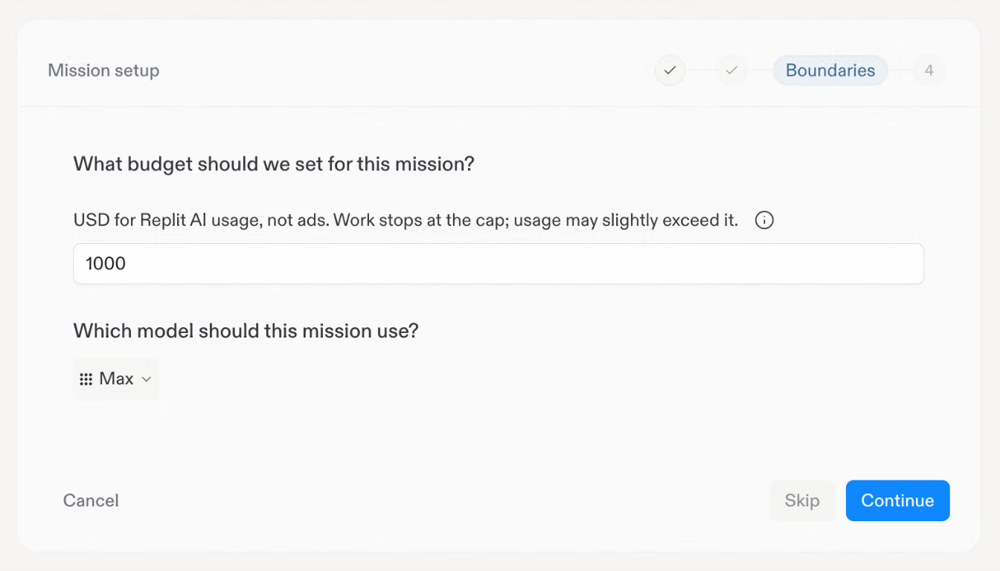
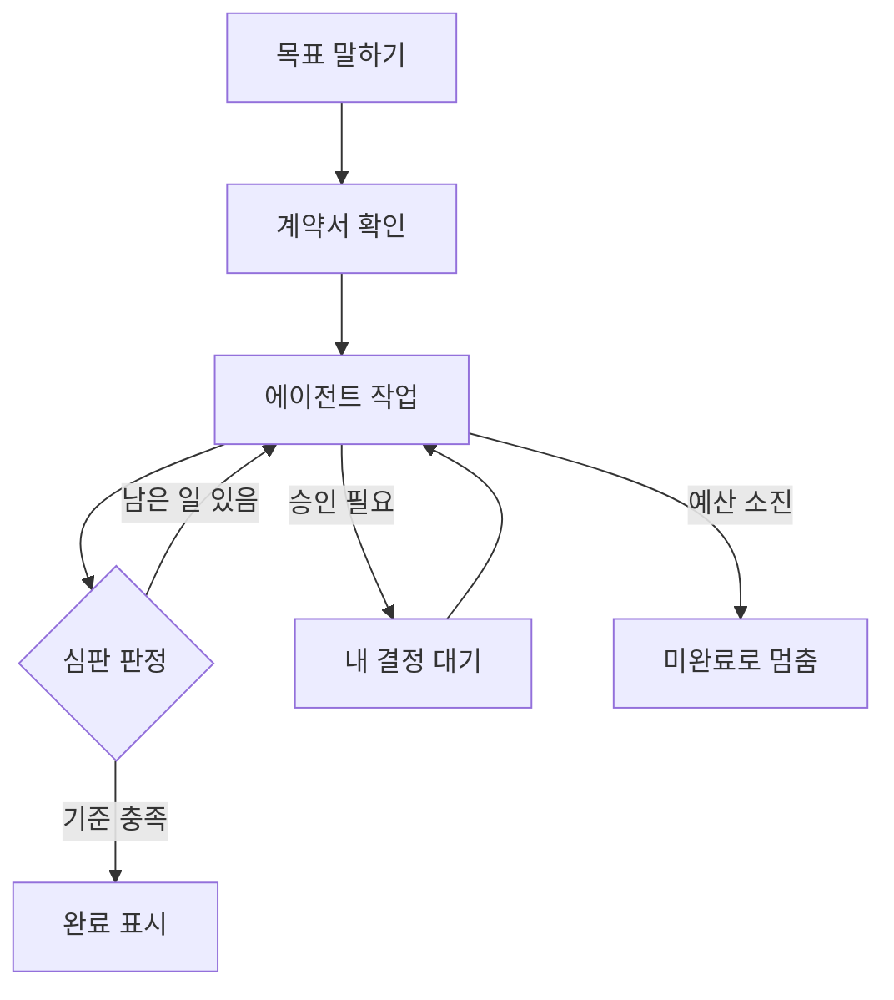

고객이 올린 버그 25건, 몇 달째 미뤄 둔 사내 도구처럼 한 번의 지시로는 끝나지 않는 일이 있다. 에이전트에게 오래 맡기자니 어디서 멈출지, 비용이 어디까지 갈지 모른다. Replit이 11월 17일 내놓은 Missions는 목표·성공 기준·달러 예산·승인 범위를 계약서 한 장에 먼저 적고, 여러 에이전트가 그 기준을 채울 때까지 나눠 일하게 한다. 이 글을 읽으면 미션을 시작하는 순서와, 돈과 결과를 놓치지 않으려면 계약서의 어느 칸을 어떻게 적어야 하는지 판단할 수 있다.

{: .summary }
> - 채팅에 **/mission**과 목표를 적으면 접근법·성공 기준·예산·승인 범위를 담은 **계약서**가 만들어지고, **Confirm and start**를 눌러야 일이 시작된다.
> - 예산은 **상한**일 뿐이다. 돌던 작업 때문에 조금 넘을 수 있고, 기준을 못 채운 채 다 쓰면 **결과 없이 멈춘다**.
> - 미션을 **지워도** 뒤에서 돌던 작업과 이미 한 행동은 그대로 남는다. 멈추려면 **따로 멈춰 달라고** 해야 한다.

## Missions는 할 일이 아니라 결과를 맡긴다

보통 에이전트 채팅은 "이 버그를 고쳐 줘"처럼 할 일을 하나씩 준다. Missions는 채팅에 오래 유지되는 목표를 붙인다. 목표는 대화가 이어지고 세션을 다시 열어도 그 채팅에 남고, 내 답이나 예약된 작업을 기다리는 동안에도 꺼지지 않는다.

일을 시작하기 전에 Replit과 함께 정하는 칸은 네 개다.

| 칸 | 정하는 것 |
|---|---|
| 접근법 | 어떤 방식으로 일을 풀지 |
| 성공 기준 | 무엇을 채우면 끝난 것으로 볼지 |
| 예산 | 미션에 쓸 Replit AI 사용료 상한(달러) |
| 경계 | 내 승인을 받을 행동, 절대 하지 말 행동 |

에이전트 여러 개가 동시에 움직인다는 점도 다르다. 발표 글의 영업 예시에서는 한 에이전트가 고객사를 조사하는 동안 다른 에이전트가 데모를 만들고, 보낸 메일의 반응을 보고 다음 작업 방향을 바꾼다. 노트북을 닫아도 클라우드에서 계속 돌고, 막힘·진행·상태 알림을 바로 받을지, 하루 한 번 묶어 받을지, 주 1회 받을지 고를 수 있다.

## 시작 순서: 계약서를 확인해야 돌기 시작한다

채팅에서 미션을 시작해 달라고 하거나 `/mission` 뒤에 목표를 적는다. 사이드바의 New에서 Mission을 골라도 된다. 질문을 하나씩 따져 묻는 Work through the details와, 질문을 줄이고 바로 계약서를 보여 주는 Only the essentials 중 하나를 고른 뒤 아래 단계를 지난다.

1. Understand: 무엇을 왜 하려는지, 지금 가진 것이 무엇인지 답한다
2. Approach: 제안된 접근법 중 하나를 고르거나 직접 적는다
3. Success: 끝났다고 볼 결과를 점검할 수 있는 말로 적는다
4. Boundaries: 예산 상한(USD)과 미션에 쓸 모델, 먼저 물어볼 행동과 금지할 행동을 정한다
5. Review and start: 옆 창의 Mission contract를 확인하고 Confirm and start를 누른다
{: .steps }

계약서에 Draft 표시가 남아 있으면 미션은 아직 시작되지 않은 상태다. 도중에 목표·성공 기준·권한·예산을 바꾸고 싶으면 무엇을 바꾸는지 분명히 말하고, 갱신된 계약서에서 바뀐 값을 다시 본다.

## 성공 기준은 '한 일'이 아니라 '확인할 수 있는 결과'로 쓴다

Replit이 일을 끝내려 할 때마다 자동 평가자(AI 심판)가 남은 증거를 성공 기준과 맞춰 본다. 기준을 채웠으면 채팅에 Mission complete가 뜨고, 아니면 남은 일을 짚어 에이전트에게 돌려보낸다. 기준이 흐리면 심판이 판정할 근거도 흐려지기 때문에, Replit도 할 일 목록 대신 결과와 대조할 수 있는 기준을 고르라고 안내한다.

| 흐린 기준 | 점검할 수 있는 기준 |
|---|---|
| 버그를 고친다 | 고객이 올린 25건을 하나씩 고쳐 테스트하고, 못 고친 건은 요약으로 남긴다 |
| 슬라이드 가져오기를 개선한다 | 원본 PPT와 얼마나 같아야 하는지 먼저 정하고 그 수준까지 고친다 |
| 기업 고객을 늘린다 | 최소 금액 이상 연간 계약 10곳(유료 시범 사용은 빼기) |

표의 오른쪽은 Replit 문서와 발표 글의 예시를 바탕으로 정리했다. Mission complete가 떠도 결과가 맞다는 보증은 아니다. Mission report를 열어 성공 기준과 직접 맞춰 보고, 못 채운 요구는 채팅에 다시 알려야 한다.

## 예산은 상한이고, 완료를 보장하지 않는다

예산은 광고비가 아니라 미션 전체에 쓸 Replit AI 사용료의 최대치다. 미션이 켜져 있는 동안 내가 보내는 메시지도 이 예산에서 빠진다. 이미 돌던 작업이 있으면 멈추기 전에 상한을 조금 넘길 수 있고, 기준을 채우기 전에 예산이 바닥나면 결과가 안 난 채로 멈춘다. 제품 페이지 FAQ에 "어느 요금제에 포함되나"라는 질문은 있지만, 11월 25일 현재 답에는 요금제 이름이 없다.

경계 칸은 돈 말고 행동을 묶는다. 발표 글의 예시는 예산을 1,000달러로 잡고, 잠재 고객에게 연락하기, 제안서 보내기, 고객용 영업 자료 고치기, 제품 약속하기 전에는 승인을 받게 한다. 접근법이 바뀌어도 이 제한과 승인 조건은 그대로 유지되고, 미션이 쓸 수 있는 커넥터도 고를 수 있다.

{: .warning }
미션을 지우는 것(clear)과 실행을 멈추는 것은 다른 동작이다. 목표를 지워도 뒤에서 돌던 작업은 취소되지 않고, 이미 한 행동도 되돌려지지 않는다. 멈추려면 돌고 있는 작업을 찾아 멈춰 달라고 따로 요청하고, 멈추지 못한 작업이 있다는 답이 오는지 확인한다.

## Replit이 내놓은 숫자는 '자기 시험'으로 읽는다

  
<b>2일·3,000달러</b>사내 모니터링 플랫폼 DataCat을 만든 기간과 예산 상한

  
<b>4배 → 19배</b>NumPy 과제 13개 속도 향상, 에이전트 1개 → 32개 스웜(Auto (Max))

  
<b>38초</b>일부러 넣은 DB 버그를 DataCat이 알린 시간(목표 60초)

Replit은 Missions로 대시보드·알림·트레이싱을 갖춘 모니터링 플랫폼 DataCat을 만들고, 정확성·알림 점검 51개를 모두 통과했다고 밝혔다. 같은 첫 프롬프트로 Claude Code의 /goal로 만든 결과와 비교하면 DataCat은 로그·지표·호스트 데이터·트레이스를 모두 받았고 Claude Code 쪽은 로그만 받았다. 반대로 Claude Code 쪽은 다룬 제품 영역이 더 넓고 로그를 더 빨리 받았다. DataCat의 자체 호스팅판은 오픈 소스로 공개했다.

{: .interpret }
이 숫자들은 Replit이 직접 설계한 시험 결과다. 비교 빌드는 설정마다 한 번씩만 돌렸고, 원래 쓰던 모니터링 플랫폼의 호스팅 서비스나 Replit 운영 환경에서 잰 성능은 아니라고 Replit 스스로 적었다. 내 일에 맞는지는 작은 예산과 좁은 성공 기준으로 미션 하나를 돌려 본 뒤 판단하는 편이 안전하다.

Missions의 결과는 에이전트 수보다 계약서 문장에서 갈린다. 첫 미션을 열기 전에 성공 기준 한 줄을 테스트 코드처럼 통과·실패로 가를 수 있는지부터 따져 보자.

출처 4곳

- Replit 블로그, 「Introducing Replit Missions」(2026-11-17 게시, 11-19 갱신): [blog.replit.com](https://blog.replit.com/introducing-replit-missions)
- Replit Docs, 「Missions」: [docs.replit.com](https://docs.replit.com/features/chats-and-routines/missions)
- Replit Docs, 「What's new」 2026년 11월(11-20): [docs.replit.com](https://docs.replit.com/updates)
- Replit, 「Missions」 제품 페이지 FAQ: [replit.com](https://replit.com/missions)

