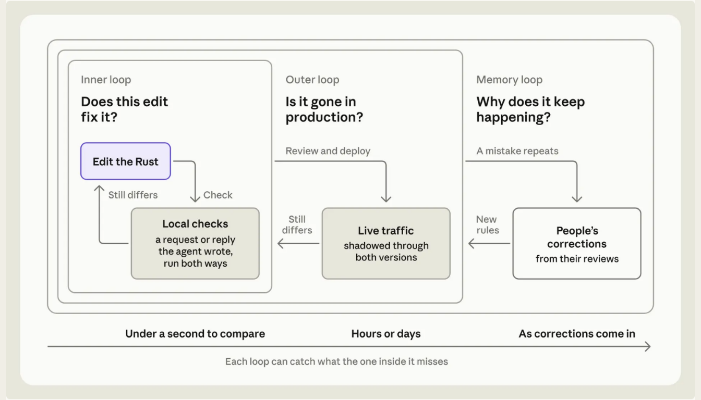
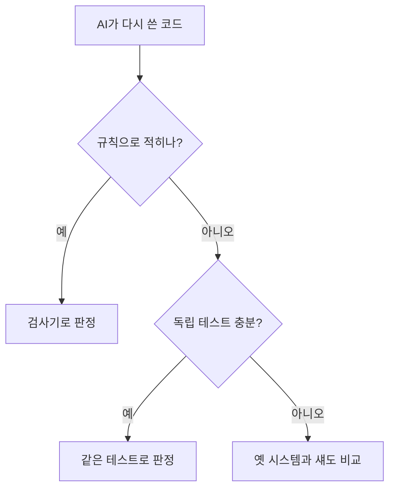

AI 코딩 에이전트가 핵심 코드를 새 언어로 일주일 만에 다시 써 왔고, 테스트도 거의 다 통과한다. 그래도 이 코드를 고객 트래픽에 올려도 되는지는 누구도 장담하지 못한다. Anthropic이 11월 25일 공개한 엔지니어링 글은 Messages API를 Python에서 Rust로 옮기며 이 질문을 푼 기록이다. 이 글을 읽으면 AI가 다시 쓴 코드를 무엇으로 믿을지 고르고, 운영 서비스를 멈추지 않고 옮길 때 섀도 비교와 검증 루프를 어떤 순서로 붙일지 정할 수 있다.

{: .summary }
> - Rust판은 4월에 테스트를 **약 98%** 통과했지만, 운영 트래픽에서 입력이 같았던 요청은 **약 4분의 1**뿐이었다.
> - 운영 중인 Python API를 정답지로 두고 같은 요청을 양쪽에 흘려 비교한 뒤, 차이를 **지문**으로 묶어 새 종류만 에이전트에게 넘겼다.
> - **1초 안 로컬 검사 → 운영 트래픽 확인 → 사람 교정의 규칙화** 세 루프로, 서비스를 끄지 않고 요청당 CPU를 약 70% 줄였다.

## 코드는 일주일, 믿을 근거는 따로 필요했다

Messages API는 고객과 Claude Code·Cowork 같은 Anthropic 앱이 Claude에 닿는 주 통로다. 2024년 초부터 올가을까지 트래픽이 약 1,800배 늘면서, 요청마다 객체를 만들고 메모리를 치우는 Python의 부담이 커졌다. 처음엔 느린 부분인 모델 출력 해석만 Rust로 바꿨는데, CPU는 8~10% 주는 데 그쳤고 토큰 하나가 Python과 Rust 사이를 세 번 오가는 새 부담이 생겼다.

전체 재작성은 2024년만 해도 "Go나 Rust로 다시 쓰지 않는다"는 말로 일단락된 일이었다. 그런데 2026년 5월에는 Anthropic이 머지하는 코드의 80% 넘게를 Claude가 쓰고 있었고, 요청 처리 핵심 경로의 첫 Rust판도 Claude가 약 일주일 만에 만들었다. 남은 문제는 이 코드가 운영 API와 똑같이 동작한다는 걸 어떻게 믿느냐였다. Anthropic은 이를 "생성이 아니라 검증이 병목"이라고 정리했다.

기존 통합 테스트는 약 700개였다. 하지만 테스트가 과금·속도 제한을 Python 메모리 안에서 흉내 내는 식으로 Python 구현에 묶여 있어, 코드와 함께 테스트도 옮겨야 했다. 나중에 옮긴 테스트를 감사하니 검사를 느슨하게 바꾼 단언이 100개 넘게 나왔다. '통과'가 코드가 맞다는 뜻인지, 테스트가 헐거워졌다는 뜻인지 가릴 수 없게 된 셈이다.

기능이 수십 개라 옵션 조합을 다 돌려 볼 수도 없었다. 그 결과가 테스트 98% 통과, 운영 입력 일치 4분의 1이라는 간극이다. 예를 들어 Python은 JSON 도구 호출 안의 이모지를 문자 코드로 바꿔 쓰고 Rust는 그대로 써서, 두 프롬프트가 몇 바이트씩 달랐다. 테스트에선 한 사례가 한 번 세지지만, 운영에선 흔한 버그 하나가 그 버그를 건드리는 모든 요청에서 어긋남을 만든다.

'맞다'를 정하는 방법은 셋이다. 규칙으로 적을 수 있으면 검사기(수학 증명의 Lean)가 단계마다 판정하고, 독립 테스트가 충분하면 같은 테스트로 옛판과 새판을 함께 판정한다(Bun이 Zig에서 Rust로 옮길 때 TypeScript 테스트를 그대로 쓴 경우). 둘 다 모자라면 운영 중인 옛 시스템 자체를 정답지로 쓴다. Messages API는 마지막 경우였고, 옛 API도 새 모델·기능 출시로 계속 바뀌어 정답이 움직이는 과녁이었다.

## 운영 API를 정답지로 쓰는 법: 모델은 한 번만 부른다

같은 요청을 옛 코드와 새 코드에 모두 흘려 결과를 비교하는 방식을 섀도잉이라고 한다. 흔한 섀도잉 도구는 요청을 두 번 실행해도 안전하고 결과가 늘 같다고 가정하는데, 여기선 둘 다 맞지 않았다. 요청은 고객의 한도와 청구서에 한 번만 잡혀야 했고, Claude는 같은 입력에도 답이 달라진다. 그래서 모델은 한 번만 부르고, 그 출력을 Rust 쪽에 다시 흘려 넣었다.

{: .warning }
요청을 그대로 두 번 실행하는 섀도잉은 과금·사용 한도처럼 한 번만 일어나야 하는 일도 두 번 일으킨다. 이런 단계는 한 번만 실행하고, 얻은 결과를 새 코드에 재생해 비교한다.

모델 호출 앞뒤의 모든 단계는 정확히 같아야 했다. Claude는 거의 어떤 프롬프트도 받아들이기 때문에, 프롬프트가 조금만 달라져도 오류 없이 답만 미묘하게 바뀐다. 게다가 개인정보 보호를 위해 고객 요청과 답의 원문은 보지 않았다. 그래서 텍스트 대신 '차이의 모양'을 기록했다.

체크포인트는 두 판이 같은 순서로 거치는 단계(요청 수락·거부, 설정 해석, 프롬프트 조립)의 중간 결과를 하나씩 비교해 처음 갈라진 단계를 찾는다. 지문(fingerprint)은 프롬프트에서 차이가 시작된 위치와 두 판의 길이 차이를 적은 것으로, 버그 하나는 영향을 준 모든 요청에 같은 지문을 남긴다. 버그 하나가 거의 같은 기록을 수십만 건 만들어도, 지문으로 묶으면 버그 단위로 정리된다.

10~30분마다 도는 스크립트가 이 기록을 어긋난 칸별로 묶고, 처음 보는 종류가 나올 때만 조율 역할의 Claude 에이전트를 깨웠다. 조율 에이전트는 새 종류마다 작업 에이전트 하나를 붙이고, 공유 Slack 채널에 스레드를 열어 엔지니어가 지켜보며 방향을 잡게 했다.

## 검증 루프 세 개: 1초, 몇 시간, 사람의 교정

| 루프 | 묻는 것 | 속도와 방법 |
|---|---|---|
| 안쪽 | 이 수정이 차이를 없애나? | 1초 안, 샌드박스에서 두 판 비교 |
| 바깥 | 운영에서도 사라졌나? | 몇 시간~며칠, 섀도 트래픽에서 지문 확인 |
| 기억 | 왜 같은 실수가 반복되나? | 교정이 들어올 때마다, 규칙·테스트로 |

처음엔 에이전트가 기록을 보고 원인을 추측해 PR을 열고, 리뷰·머지·스테이징 배포를 거친 뒤에야 맞았는지 알았다. 한 번 확인에 몇 시간에서 며칠이 걸렸다. 그래서 두 코드베이스가 다 든 클라우드 샌드박스를 에이전트마다 주고, 각 판이 모델에 보낼 프롬프트를 만들어 비교하는 입력 검사(모델을 부르지 않아 1초 안)와 가짜 모델에 정해진 답을 흘리는 출력 검사를 붙였다. 에이전트는 지문만 보고 원인을 짐작해 재현 요청을 직접 쓰고, 같은 모양의 차이가 나오면 Rust를 고친 뒤 고치기 전 코드에선 실패하고 고친 코드에선 통과하는 테스트까지 더했다.

안쪽과 바깥 루프 사이의 PR 리뷰가 사람의 자리였다. 5월 중순 웹 검색 도구 설명이 프롬프트에서 빠지는 차이를 두고, 한 에이전트는 설명 문구를 파일로 복사해 Rust가 읽게 하는 지름길을 냈다. 프롬프트는 같아졌고 로컬 검사도 통과했지만, 엔지니어는 출시 전에 어차피 Rust가 그 내부 서비스를 직접 불러야 하니 버릴 코드라며 거절했다. 검증기는 결과가 같은지만 알려 줄 뿐 출시해도 될 수정인지는 판단하지 못한다는 것이 Anthropic의 정리다.

바깥 루프는 수정이 들어간 빌드와 빠진 빌드를 섀도 트래픽에서 비교해 그 지문이 사라졌는지 본다. 공정한 비교를 위해 요청 원문 대신 모델과 쓰인 기능(프롬프트 캐싱, 도구, 확장 사고 등)만 기록해 같은 종류끼리 맞댔다. 샌드박스에선 통과했는데 운영에서 차이가 남으면 그 과제는 다시 안쪽 루프로 돌아갔다.

기억 루프는 같은 교정을 두 번 하지 않게 한다. 웹 검색 건의 거절 이유는 메모로 남았고, 이후 위치가 다른 지문이 새로 나와도 에이전트들은 이를 같은 버그로 묶을 뿐 지름길을 다시 쓰지 않았다. "Python이 한 일을 그대로 옮긴다"는 규칙이 생기자 한 에이전트가 추측에 기댄 곳 7군데를 더 찾았고, 6월에는 리뷰 댓글 약 60개를 묶어 CLAUDE.md 규칙 후보를 냈다. 반복되는 지적은 결국 테스트, 린트, 그리고 Python을 고치면 Rust도 같이 고치거나 예외를 요청하게 하는 머지 검사로 굳었다.

## 입력 일치 99.6%, 9월에 공개 트래픽 전환

입력 일치율은 4월 말 24%에서 시작해 5월 초 6.5%까지 내려갔다가, 수정이 쌓이며 8월에 99.6%가 됐다. 공개 트래픽은 2026년 9월 Rust로 넘어갔고, 그동안 서비스를 내리거나 기능 개발을 멈추지 않았다. 아래 숫자는 전환 직전 수준과 비교한 값이다.

  
<b>약 −70%</b>요청당 CPU(한 리전 기준)

  
<b>80% 넘게 감소</b>요청당 메모리(운영 전체)

  
<b>약 −20%</b>첫 토큰까지 시간 중앙값(고객 Claude Code 요청)

## 우리 팀 마이그레이션에 옮기는 순서

Anthropic이 글 끝에 정리한 교훈을 작업 순서로 다시 놓으면 이렇다.

1. 정답부터 고른다: 규칙, 독립 테스트, 운영 중인 옛 시스템 중 무엇으로 판정할지 위 흐름도로 정한다
2. 옛 시스템을 정답지로 쓰면 과금·한도처럼 두 번 일어나면 안 되는 단계는 한 번만 실행하고, 매번 달라지는 결과는 한 번 얻어 새 코드에 재생한다
3. 최종 응답만 보지 말고 단계별 중간 결과를 비교해, 처음 갈라진 단계·위치·길이를 지문으로 남긴다
4. 에이전트 작업 공간에 1초 안에 도는 로컬 비교를 두고, 재현부터 수정, 고치기 전 코드에서 실패하는 테스트까지 맡긴다
5. 사람은 PR 경계에서 '버그인가 의도된 변경인가', '버릴 코드인가'를 보고, 같은 교정은 규칙 문서·테스트·린트로 남긴다
{: .steps }

{: .interpret }
작은 팀이 그대로 가져갈 부분은 에이전트 수가 아니라 차이를 적는 기록의 모양이다. '어느 단계, 몇 번째 조각, 몇 바이트에서 갈렸나'만 남겨도 사람이든 에이전트든 같은 버그를 한 번만 고치게 된다. 반대로 결과만 같으면 통과시키는 검증기 하나에 기대면, 지름길 수정이 그대로 쌓일 수 있다.

코드를 짜는 값이 싸질수록 마이그레이션 계획서의 첫 장은 일정표가 아니라 '무엇이 맞는지를 기계가 어떻게 판정하나'가 된다.

출처 1곳

- Anthropic, 「Migrating our Messages API to Rust」(2026-11-25): [anthropic.com](https://www.anthropic.com/research/migrating-api-to-rust)

