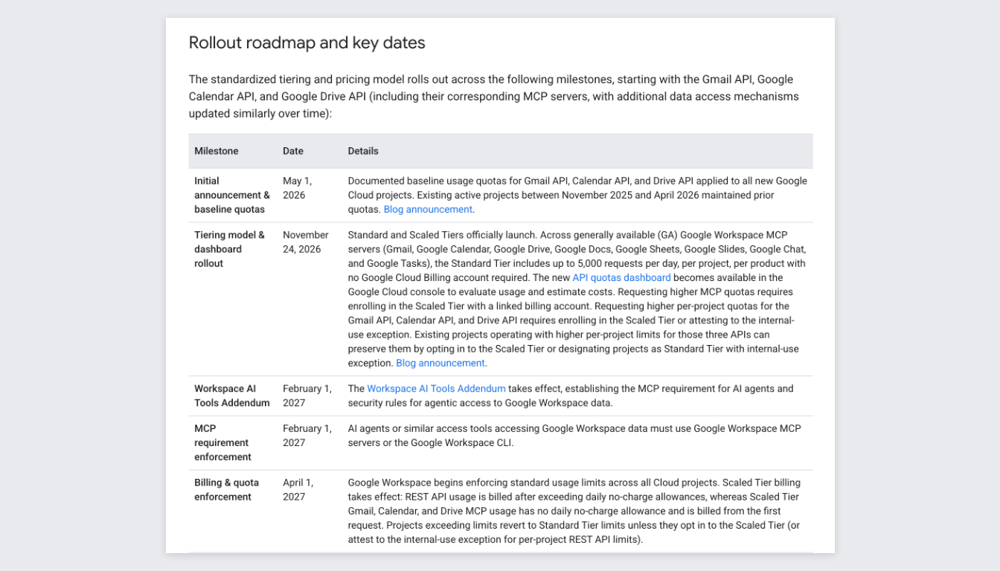
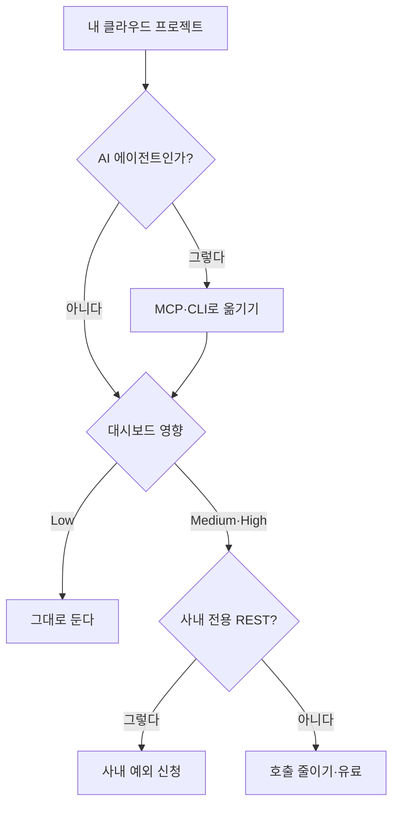

메일함을 읽고 답장 초안을 써 주는 AI 에이전트, 회의 일정을 알아서 잡는 사내 봇을 구글 클라우드 프로젝트 하나로 돌리는 팀이 많다. 구글이 11월 24일 이 통로에 무료 Standard 등급과 유료 Scaled 등급을 붙였고, 2027년 2월 1일부터는 AI 에이전트가 워크스페이스 데이터에 들어오는 길을 MCP 서버와 CLI로 정했다. 이 글을 읽으면 내 프로젝트가 무료 한도 안에 드는지 확인하고, 넘는다면 호출을 줄일지·예외를 신청할지·유료로 올릴지 고를 수 있다.

{: .summary }
> - 11월 24일부터 **Standard(무료)·Scaled(유료)** 두 등급. 지메일·캘린더·드라이브 등 MCP 서버 8개는 제품마다 **하루 5,000건**까지 결제 계정 없이 쓴다.
> - **2027년 2월 1일**부터 AI 에이전트는 워크스페이스 **MCP 서버나 CLI**로 들어와야 한다. REST API를 직접 부르는 에이전트는 등급과 관계없이 무료 한도에 묶인다.
> - **2027년 4월 1일** 과금 시작. Scaled로 올리면 지메일·캘린더·드라이브 MCP는 무료분 없이 **첫 요청부터** 1천 건당 0.10~0.50달러다.

## 무엇이 바뀌었나: 무료 Standard와 유료 Scaled

등급은 클라우드 프로젝트 단위로 정하고, 모든 프로젝트의 기본값은 Standard다. 이 등급은 결제 계정도 신용카드도 필요 없고 요금이 청구되는 일도 없다. 대신 공개된 한도를 넘으면 한도 창이 다시 열릴 때까지 요청이 막힌다.

MCP 서버의 하루 5,000건은 프로젝트마다, 제품마다 따로 센다. 지메일에서 5,000건을 다 써도 캘린더 몫은 그대로 남는다. 다만 도구 하나가 안에서 API를 여러 번 부르면 그만큼 여러 건으로 잡히고, 분당 한도도 따로 걸린다.

| 구분 | Standard | Scaled |
|---|---|---|
| 결제 계정 | 필요 없음 | 연결해야 켤 수 있음 |
| MCP 서버 | 제품마다 하루 5,000건 무료, 넘으면 막힘 | 무료분 없음, 첫 요청부터 과금 |
| REST API | 공개 한도 안에서 무료 | 결제 계정별 하루 무료분을 넘은 만큼만 과금 |
| 한도 올리기 | 신청 불가(REST는 사내 예외만) | 따로 신청 |

구글은 활동 중인 워크스페이스 개발자 가운데 Standard를 넘어설 곳이 1% 미만일 것으로 추정한다.

## 언제 무엇이 걸리나: 2027년 2월과 4월

1. **2026년 5월 1일**: 새로 만든 클라우드 프로젝트에 지메일·캘린더·드라이브 API 기본 한도 적용(2025년 11월~2026년 4월에 쓰던 프로젝트는 예전 한도 유지)
2. **2026년 11월 24일**: 두 등급과 콘솔 대시보드 공개
3. **2027년 2월 1일**: 워크스페이스 AI 도구 부속 약관(Workspace AI Tools Addendum) 발효, AI 에이전트는 MCP 서버나 CLI로 접근
4. **2027년 4월 1일**: 모든 프로젝트에 Standard 한도 적용, Scaled 과금 시작
{: .steps }

지금 예전 한도로 많이 쓰는 프로젝트도 4월 1일부터는 Standard 한도로 돌아간다. 높은 한도를 지키려면 그 전에 Scaled로 올리거나, REST API라면 사내 예외를 신청해야 한다.

{: .warning }
2027년 2월 1일부터 REST API를 직접 부르는 AI 에이전트는 Scaled로 올려도 Standard 한도에 묶인다. 돈을 내도 한도가 늘지 않으니, 에이전트가 지메일·드라이브를 REST로 읽고 있다면 MCP 서버나 CLI로 옮기는 일이 먼저다.

MCP 서버 주소는 제품마다 따로 있다(지메일은 `https://gmailmcp.googleapis.com/mcp/v1`). Claude 같은 MCP 지원 앱에 이 주소를 붙이는 방법과 개인용 빠른 설정은 구글의 MCP 서버 설정 문서에 있고, 명령줄에서 일하는 에이전트라면 워크스페이스 CLI(gwscli)로 연결해도 된다.

## Scaled로 올리면 얼마나 나오나

요금은 작업의 무게에 따라 네 칸으로 나뉜다. 캘린더는 모든 요청이 Plus 칸이고, 지메일에는 Plus 칸이 없다.

| 칸 | 1천 건당 | MCP 도구 예 |
|---|---|---|
| Light | 0.10달러 | get_file_metadata, list_labels |
| Medium | 0.20달러 | create_draft, label_message, create_file |
| Plus | 0.25달러 | 캘린더 전부, search_files, list_recent_files |
| Premium | 0.50달러 | get_thread, search_threads, read_file_content |

놓치기 쉬운 점은 Scaled로 올리는 순간 MCP의 하루 무료 5,000건이 사라진다는 것이다. 지메일 MCP로 메일 스레드를 하루 6,000번 읽는 에이전트라면(get_thread 한 번을 1건으로 칠 때), Standard에서는 5,000건까지 무료이고 나머지 1,000건은 한도가 풀릴 때까지 막힌다. Scaled에서는 6,000건 모두 Premium 값이 붙어 하루 3달러, 30일이면 약 90달러다(계산값). Scaled를 켠다고 한도가 저절로 오르지도 않아서, 더 필요하면 한도 상향을 따로 신청해야 한다.

REST API는 사정이 다르다. Scaled에서도 결제 계정마다 칸별 하루 무료분이 있고 넘은 만큼만 낸다. 지메일 Light 칸은 하루 7천만 건, 캘린더는 하루 1백만 건까지 무료라 이 안에 들면 REST 요금은 0원이다.

## 내 프로젝트는 어디에 드나: 대시보드로 보는 법

Google Cloud 콘솔에 워크스페이스 전용 화면이 생겼다. 프로젝트 보기 권한(Project Viewer 역할 정도)이 있으면 열 수 있다.

1. Google Cloud 콘솔에서 메뉴 > View all products > Google Workspace > Dashboard를 연다
2. 오른쪽 위에서 기간(1일·7일·30일)을 고른다
3. Usage and quota assessment 표에서 지메일·캘린더·드라이브 줄의 Modeled impact를 본다
4. MCP 호출 수는 Project billing usage 탭, 예상 요금은 Cost estimator 탭에서 본다
{: .steps }

Modeled impact는 지난 사용량을 Standard 한도에 대 보고 Low·Medium·High로 매긴 값이다. High는 어느 하루라도 한도에 막혔을 요청이 10건을 넘었다는 뜻이고, Low는 평균 사용률이 90% 미만에 막힌 요청이 없을 때다.

사내 예외(internal-use exception)는 같은 워크스페이스 조직 안 사람만 쓰고, API·MCP 접근을 외부 서비스와 나누지 않는 프로젝트에만 열린다. 신청은 워크스페이스 최고 관리자가 하고, 외부 사용자용 OAuth 클라이언트가 들어 있는 프로젝트는 안 된다. 이 예외로 올릴 수 있는 것도 REST API 프로젝트 한도뿐이고 MCP 한도는 해당하지 않는다.

{: .tip }
> - [ ] 에이전트 코드에서 지메일·드라이브 REST API를 직접 부르는 곳 찾기
> - [ ] Project billing usage 탭에서 제품별 MCP 하루 호출 수 확인
> - [ ] 같은 스레드·파일을 여러 번 읽는 곳에 결과 저장 넣기

## 지메일을 연결해 쓰는 사용자는 무엇이 달라지나

요금과 한도는 클라우드 프로젝트에 붙고, 과금은 그 프로젝트에 연결한 결제 계정으로 나간다. ChatGPT나 Claude 같은 앱에 지메일을 연결해 쓰는 사람은 그 프로젝트의 주인이 아니니 지금 내는 돈이나 할 일은 없다. 구글이 밝힌 목적은 AI 에이전트가 워크스페이스 데이터에 어떻게 들어와 무엇을 쓰는지 더 잘 보고 통제하는 것이다.

{: .interpret }
에이전트의 길을 MCP 하나로 모으고 호출마다 값을 매기면, 지메일을 많이 읽는 AI 앱은 그 비용을 요금제나 사용 횟수 제한으로 사용자에게 넘길 수 있다. 2027년 4월 전후로 쓰는 AI 앱의 지메일·드라이브 연결 공지를 한 번 볼 만하다.

에이전트에게 도구를 열어 줄 때 이제 권한만이 아니라 칸도 봐야 한다. 파일 정보 조회(Light)로 끝날 일을 파일 내용 읽기(Premium)부터 하게 두면, 같은 답을 얻는 데 다섯 배 값을 낸다.

출처 4곳

- Google for Developers, 「Usage tiers and quotas for Google Workspace APIs and MCP servers」: [developers.google.com](https://developers.google.com/workspace/tools-safety)
- Google for Developers, 「Understand Google Workspace API and MCP server pricing and billing tiers」: [developers.google.com](https://developers.google.com/workspace/guides/quota-pricing)
- Google for Developers, 「Monitor quota usage with the Google Workspace API dashboard」: [developers.google.com](https://developers.google.com/workspace/guides/quota-dashboard)
- Google for Developers, 「Configure the Google Workspace MCP servers」: [developers.google.com](https://developers.google.com/workspace/guides/configure-mcp-servers)

